# ABAP HCM para programadores ABAP
### Guía rápida + qué cambia con S/4HANA

> Pensada para un programador ABAP con experiencia que llega a HCM, el antiguo SAP HR. HR y HCM son lo mismo: HR es el nombre antiguo y HCM el actual.

---

## 1. Mapa mental de HCM

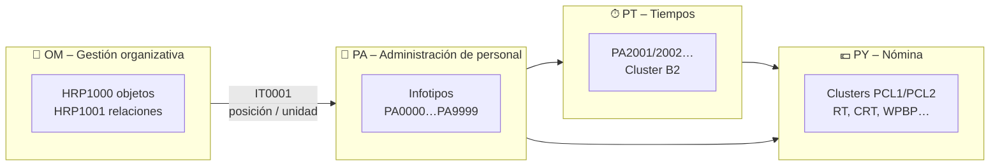

| Área | Dónde están los datos | Clave técnica |
|---|---|---|
| **PA** | Tablas `PAnnnn` (un infotipo por tabla) | `PERNR` + `SUBTY` + `BEGDA`/`ENDDA` |
| **OM** | Tablas `HRPnnnn` | `PLVAR` + `OTYPE` (O, S, C, P…) + `OBJID` |
| **PT** | `PA2001`, `PA2002`… y cluster **B2** | Resultados de la evaluación de tiempos en un cluster |
| **PY** | Clusters en **PCL1/PCL2** | Se leen con macros o clases, **nunca con SELECT** |

---

## 2. Los 6 conceptos que debes dominar

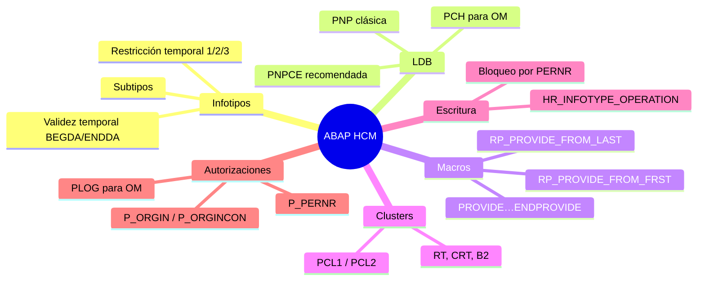

### 2.1 Infotipos: todo depende de la fecha
- Cada registro tiene **validez** (`BEGDA` a `ENDDA`, con `99991231` = "abierto").
- La **restricción temporal** de cada infotipo determina si puede haber huecos o solapes:

| Restricción | Significado | Ejemplo |
|---|---|---|
| **1** | Siempre exactamente un registro válido, sin huecos | IT0001 Asignación org., IT0002 Datos personales |
| **2** | Como máximo uno válido; se permiten huecos | IT0007 Horario de trabajo teórico |
| **3** | Puede haber varios a la vez | IT0014 Devengos/deducciones periódicos |

- Siempre hay que responder a una pregunta: **¿qué registro vale en la fecha X?**

### 2.2 Estructuras: P vs PA vs PS
| Objeto DDIC | Qué es |
|---|---|
| `PAnnnn` | Tabla transparente física |
| `Pnnnn` | Estructura de trabajo completa (clave + datos) usada en programas |
| `PSnnnn` | Solo los campos de datos del infotipo (donde se amplía con `CI_Pnnnn`) |
| `PSKEY` / `PAKEY` | Claves comunes a todos los infotipos |

### 2.3 Bases de datos lógicas (LDB)
| LDB | Uso | Nota |
|---|---|---|
| **PNP** | Datos maestros de PA | Clásica: la que aparece en casi todos los apuntes antiguos |
| **PNPCE** | Datos maestros de PA + empleo concurrente | **SAP la recomienda para desarrollos nuevos** |
| **PCH** | Gestión organizativa (OM) | Recorre estructuras de evaluación |
| **PAP** | Selección de personal | Poco habitual hoy |

Qué te da la LDB "gratis": **pantalla de selección estándar + lectura de datos + control de autorizaciones**.

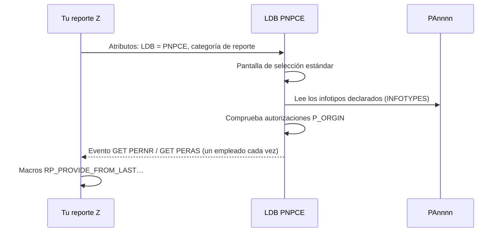

### 2.4 Leer y escribir sin LDB
| Necesidad | Herramienta estándar |
|---|---|
| Leer un infotipo | FM `HR_READ_INFOTYPE` o la clase `CL_HRPA_READ_INFOTYPE` |
| Grabar / modificar / borrar | FM `HR_INFOTYPE_OPERATION` |
| Bloquear el empleado | `BAPI_EMPLOYEE_ENQUEUE` / `BAPI_EMPLOYEE_DEQUEUE` |
| Leer OM | FM `RH_READ_INFTY`, `RH_STRUC_GET` |
| Resultados de nómina | `CL_HR_PAY_ACCESS`, FM `PYXX_READ_PAYROLL_RESULT`, `CU_READ_RGDIR` (directorio) |

> ⚠️ **Regla de oro:** nunca hagas `UPDATE`/`INSERT` directos sobre `PAnnnn`. Te saltas validaciones, acciones dinámicas, documentos de modificación e integración con OM y con Business Partner.

### 2.5 Clusters (nómina y tiempos)
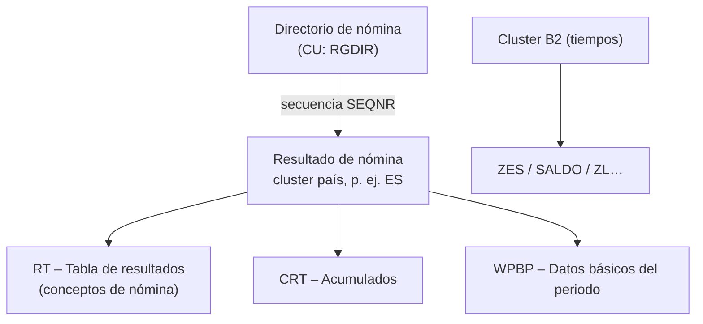
- Los resultados de nómina están guardados como datos `EXPORT … TO DATABASE` en `PCL1`/`PCL2`, no como filas legibles.
- Visualízalos con la transacción **PC_PAYRESULT**.

### 2.6 Ampliaciones típicas
| Necesidad | Cómo |
|---|---|
| Campo nuevo en un infotipo estándar | Include `CI_Pnnnn` desde **PM01** |
| Infotipo propio | **PM01**, rango **9000–9999** (tabla `PA9xxx`) |
| Validaciones al grabar | BAdI **HRPAD00INFTY** (y user exit `PBAS0001` para valores por defecto) |
| Lógica en cadena (si cambia X, crea Y) | Acciones dinámicas (tabla `T588Z`) |
| Nómina / tiempos | Esquemas y reglas (**PE01/PE02**), operaciones y funciones propias (**PE04**) |

### 2.7 Transacciones de supervivencia
`PA20/PA30` (infotipos) · `PA40` (medidas) · `PPOME` (estructura org.) · `PM01` (infotipos Z) · `PE01/PE02/PE04` (nómina/tiempos) · `PC_PAYRESULT` (resultados de nómina) · `PU03` (cambiar estado de nómina) · `HRALX`/`OOAC` en `T77S0` (conmutadores de integración)

---

## 3. 🔴 S/4HANA: ¿ha cambiado el modelo de datos de HCM?

### Respuesta corta
**On-premise / Private Cloud: no en lo esencial.** Las tablas `PAnnnn`, `HRPnnnn` y los clusters siguen existiendo y tu ABAP HR sigue siendo válido.
**Lo que sí cambia:** la integración obligatoria con **Business Partner**, el paso a **H4S4**, varias **funcionalidades retiradas** y las reglas de código para HANA.
**S/4HANA Cloud Public Edition: sí, radicalmente.** Allí no hay infotipos.

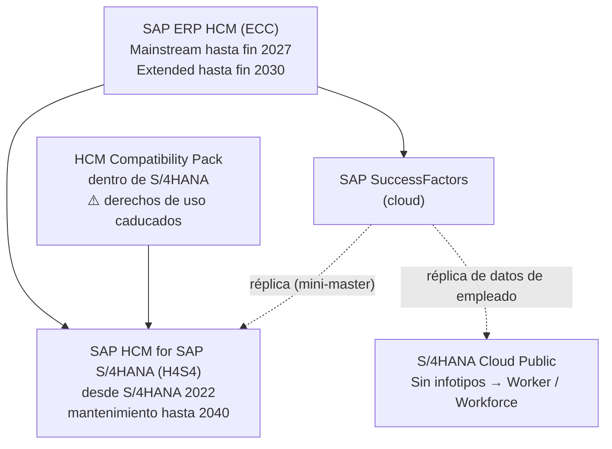

### 3.1 Calendario de soporte
| Producto | Estado |
|---|---|
| **SAP ERP HCM (ECC)** | Mainstream hasta **31/12/2027**; extended opcional hasta **31/12/2030** |
| **HCM Compatibility Pack** (HCM "clásico" corriendo dentro de S/4HANA) | Derechos de uso on-premise caducados: el plazo era fin de 2025 y SAP lo amplió a **31/05/2026**. En suscripción cloud el límite es **31/12/2030** |
| **H4S4** | Disponible desde **S/4HANA 2022**, mantenimiento hasta **2040** |

### 3.2 Qué NO cambia (on-premise / PCE)
| ✅ Sigue igual | Detalle |
|---|---|
| Tablas `PAnnnn` | Mismas tablas y mismos infotipos |
| OM (`HRP1000`, `HRP1001`…) | Igual |
| Clusters `PCL1`–`PCL4` | Igual (nómina y tiempos) |
| LDB PNP/PNPCE/PCH, macros | Igual |
| `HR_READ_INFOTYPE`, `HR_INFOTYPE_OPERATION`, BAdIs de PA | Igual |
| Esquemas y reglas de nómina | Igual |

H4S4 **no es un producto nuevo desde cero**: es la continuación de ERP HCM con optimizaciones.

### 3.3 Qué SÍ cambia ⚠️
#### a) Integración Empleado ↔ Business Partner (obligatoria)
En S/4HANA **cada empleado debe tener un Business Partner**. Afecta a viajes, compras, FI, usuarios, etc.

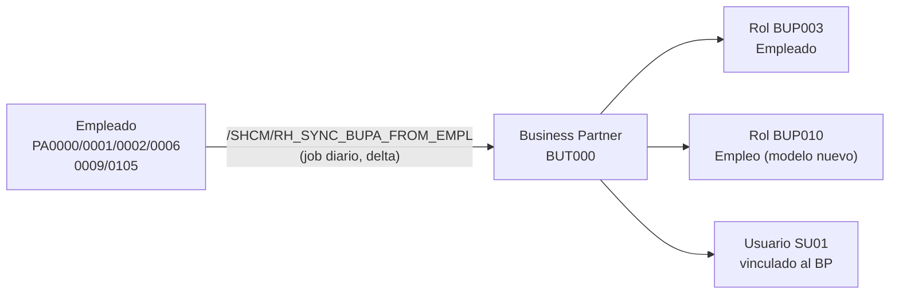

| Elemento | Qué saber como programador |
|---|---|
| Sincronización inicial | `/SHCM/RH_SYNC_BUPA_EMPL_SINGLE` |
| Sincronización delta | `/SHCM/RH_SYNC_BUPA_FROM_EMPL` (job diario) |
| Modelo nuevo (S/4HANA 2020+) | Business function **/SHCM/EE_BP_1**: un BP de persona con roles **BUP003** y **BUP010** (empleo) |
| Logs | **SLG1** |
| Ojo con | Programas antiguos de acreedores de empleados (p. ej. `RPRAPA00`/PRAA) quedan **obsoletos** por la integración con BP |
| Ojo con | No uses módulos de función no liberados como `/SHCM/TRIGGER_BUPA_SYNC` en desarrollos Z: pueden fallar en upgrades |
| Personalización del BP | La BAdI de sincronización no siempre se ejecuta en todos los modos: revisa las notas antes de depender de ella |

#### b) H4S4: activación y funciones retiradas
- Se activa con la business function **H4S4_1**, que añade comprobaciones y mensajes en algunos infotipos y reportes.
- Algunas funcionalidades "no estratégicas" del Compatibility Pack **desaparecen** al activar H4S4. Entre las mencionadas por SAP:

| ❌ Retirado / simplificado (ejemplos) |
|---|
| Appraisal Systems, Career & Succession Planning, Development Plans |
| Compensation Management, Cost Planning |
| Employee Interaction Center, Manager's Desktop |
| ESS/MSS antiguos (ITS, WD Java, HTMLB) |
| Partes de Gestión de tiempos: **IT0005, IT0083, IT2005** con sus reportes y FMs |
| Recruiting (PA-RC), servicios SOA de PA/PT |
| Algunos reportes de nómina (`RPCS0000`, `RPCSC000`…) |

> 👉 **Acción para el programador:** inventaria tu código Z y busca referencias a estos objetos e infotipos antes de la migración.

#### c) Código custom "HANA-ready"
| Tema | Qué revisar |
|---|---|
| `SELECT` sin `ORDER BY` | HANA **no garantiza el orden** (afecta, por ejemplo, a `READ … BINARY SEARCH` posteriores) |
| Native SQL / hints de BD | Revisar o eliminar |
| Objetos retirados | Usa **ATC** con la variante de *S/4HANA Readiness* y **Custom Code Migration** |
| Rendimiento | Considera **CDS views** y AMDP para reporting masivo de PA/OM |

#### d) Interfaz y extensibilidad
- Más **Fiori/UI5** (aplicaciones de empleado y responsable) en lugar de ESS/MSS clásicos.
- Para exponer datos de HCM a apps nuevas: **CDS + OData / RAP** encima de las tablas de PA. Esto conecta directamente con tu aprendizaje de RAP.

### 3.4 S/4HANA Cloud **Public** Edition: otro mundo
| Aspecto | Public Cloud |
|---|---|
| Infotipos | **No existen** como en HCM: se sustituyen por la app **Worker** |
| Dueño de los datos de RR. HH. | **SuccessFactors** (o un HRIS externo); en S/4HANA son de solo lectura |
| Datos almacenados | Solo lo mínimo que necesitan los procesos de S/4HANA (finanzas, compras…) |
| ABAP | Solo **ABAP Cloud** con APIs liberadas; nada de PNP, macros ni `PAnnnn` |

### 3.5 Resumen en una imagen
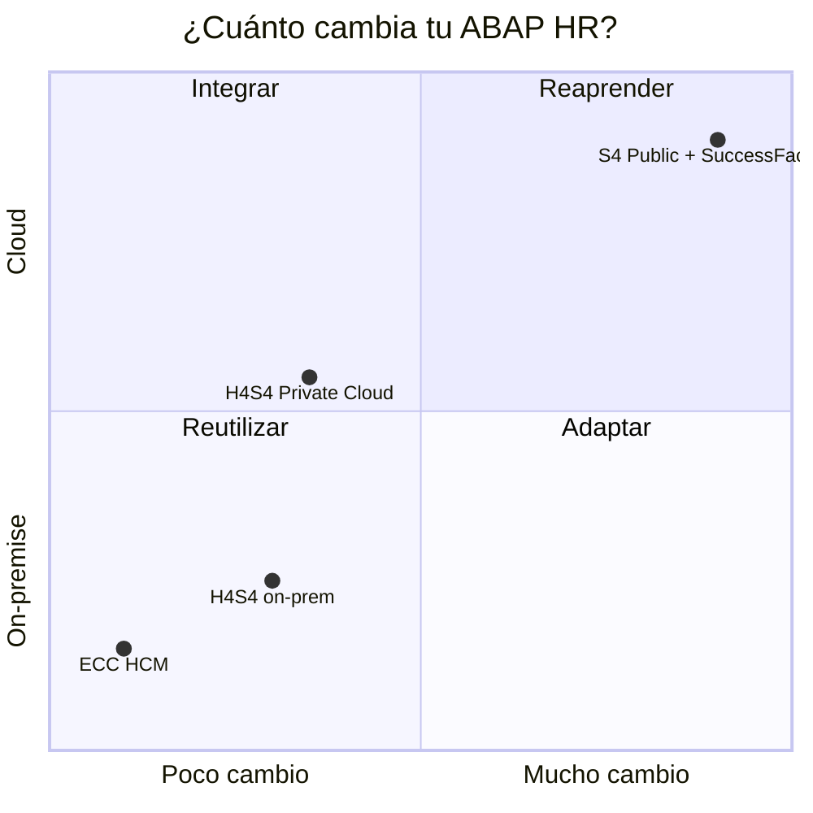

---

## 4. 🧩 Datos de HCM en Fiori con CDS + RAP

### 4.1 Arquitectura de referencia
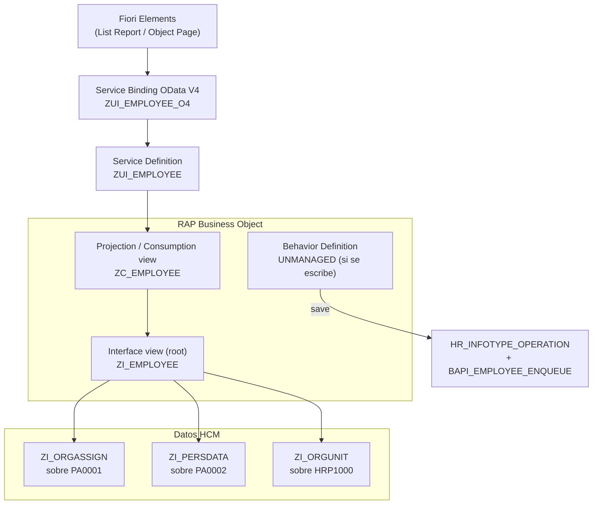

### 4.2 Lo que distingue a HCM de una app RAP "normal"
| Reto HCM | Por qué choca con RAP | Solución recomendada |
|---|---|---|
| **Validez temporal** (BEGDA/ENDDA) | Una entidad RAP espera una fila por clave; un infotipo tiene muchas | Exponer **"vigente a fecha"** con un parámetro de fecha o un filtro `fecha BETWEEN begda AND endda` en la vista base, o modelar la **historia** como entidad hija |
| **Clave compleja** | PERNR + INFTY + SUBTY + OBJPS + SPRPS + ENDDA + BEGDA + SEQNR | Clave completa en la vista de historia; solo **PERNR** en la raíz "empleado" |
| **Autorizaciones HR** | P_ORGIN tiene lógica temporal, estructural (OM) y de nº propio (P_PERNR) que **DCL no reproduce entera** | Para un Z sencillo: DCL con `PFCG_MAPPING` sobre campos de PA0001 (PERSA, PERSG, PERSK, VDSK1). Para máxima fidelidad: **custom entity + query provider** que lea con APIs HR (aplican la comprobación estándar) |
| **Escritura** | Un BO *managed* escribe directo en la tabla, lo que en `PAnnnn` está **prohibido** | BO **unmanaged** (o managed con *unmanaged save*) que llama a `HR_INFOTYPE_OPERATION` |
| **Bloqueos** | Los bloqueos RAP se basan en objetos de bloqueo propios | En el lock handler: `BAPI_EMPLOYEE_ENQUEUE` por PERNR |
| **Clusters** (nómina, tiempos) | No son tablas: no se pueden leer con CDS | **Custom entity** con query provider ABAP que llame a `CL_HR_PAY_ACCESS` |
| **Integración con BP** | Tras grabar en PA debe ejecutarse la sincronización con BP | Usa la API estándar; **no** llames tú a FMs `/SHCM/*` no liberados |

### 4.3 Dos patrones según el caso
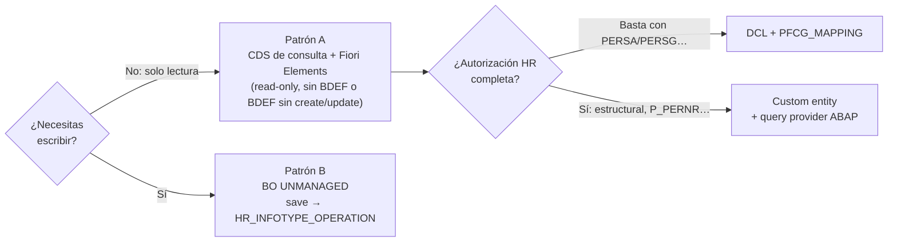

| | Patrón A: solo lectura | Patrón B: lectura y escritura |
|---|---|---|
| Esfuerzo | Bajo | Medio-alto |
| Fuente | CDS sobre `PAnnnn` / `HRPnnnn` | Igual + clase de comportamiento |
| Escritura | — | `HR_INFOTYPE_OPERATION` en el **save** (no en las *modify*) |
| Validaciones | — | Mejor dejar que el estándar valide (BAdI HRPAD00INFTY) y devolver sus mensajes como `reported` |
| Draft | — | Posible, pero la tabla de draft es Z; el registro real se graba solo al **activar** |

### 4.4 ABAP Cloud y el modelo de 3 niveles
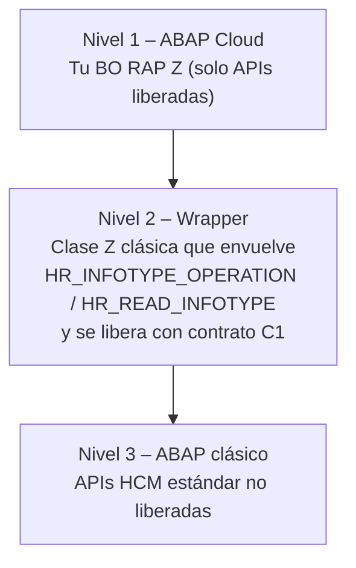
- En **S/4HANA on-premise / Private Cloud** casi todas las APIs de HCM **no están liberadas** para ABAP Cloud.
- Si desarrollas en *ABAP for Cloud Development*, crea un **wrapper (nivel 2)** y libéralo. Si desarrollas en *Standard ABAP*, puedes llamarlas directamente, pero pierdes "cloud-readiness".
- En **S/4HANA Cloud Public** no hay PA: los datos de empleado se consumen con CDS liberadas del dominio Workforce, como `I_WorkforcePerson` o `I_PersonWorkAgreement_1` (la antigua `I_PersonWorkAgreement` está **deprecada**).

### 4.5 Ejemplo de diseño: "Mi equipo"
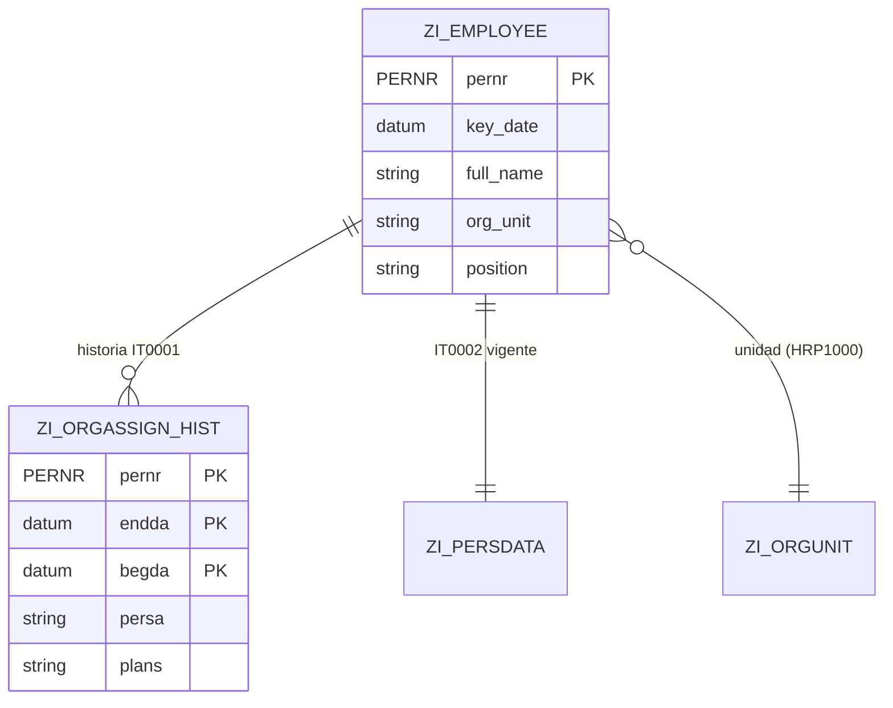
- **Raíz:** empleado con los datos "vigentes hoy".
- **Hija:** historia de la asignación organizativa (IT0001), en solo lectura.
- **Acción** (si se escribe): "Cambiar dirección", que genera un registro de IT0006 con `HR_INFOTYPE_OPERATION` y delimita el anterior.

---

## 5. Checklist del programador ABAP HCM en S/4HANA
- [ ] Usar **PNPCE** en lugar de PNP en reportes nuevos
- [ ] Grabar siempre con `HR_INFOTYPE_OPERATION`, con bloqueo previo
- [ ] Revisar el código Z con **ATC** (S/4HANA readiness)
- [ ] Buscar referencias a **IT0005, IT0083, IT2005** y a los módulos retirados en H4S4
- [ ] Entender la **sincronización Empleado → BP** y revisar SLG1
- [ ] No usar FMs `/SHCM/*` no liberados en desarrollos Z
- [ ] Añadir `ORDER BY` donde el código dependa del orden
- [ ] Para Fiori: **CDS + RAP** sobre PA/OM; escritura solo vía BO *unmanaged* + `HR_INFOTYPE_OPERATION`
- [ ] Decidir cómo replicar P_ORGIN: DCL (`PFCG_MAPPING`) o custom entity con APIs HR

---

## 6. Lecturas recomendadas
| Recurso | Tipo |
|---|---|
| *SAP ERP HCM: Technical Principles and Programming*, Liepold & Ritter (SAP PRESS, 2.ª ed.) | Libro, PDF de pago |
| *SAP ERP HCM: Custom Report Development* (SAP PRESS, E-Bite) | PDF corto, de pago |
| Curso oficial SAP **HR350** (Programming in HR) | Temario PDF |
| SAP KBA **2578294** y **3023906**: FAQ de la sincronización Empleado ↔ BP (modelo antiguo y nuevo) | SAP for Me |
| SAP Learning: *Time Management in SAP HCM for S/4HANA*, simplificaciones | Gratis |

### Fuentes consultadas
- [SAP PRESS – SAP ERP HCM: Technical Principles and Programming](https://www.sap-press.com/sap-erp-hcm-technical-principles-and-programming_3698)
- [SAP Community – What is SAP HCM for S/4HANA (H4S4)](https://community.sap.com/t5/enterprise-resource-planning-blog-posts-by-members/bridge-options-for-sap-successfactors-customers-part-2-what-is-sap-hcm-for/ba-p/13552605)
- [All for One – End of support for Compatibility Scope](https://www.all-for-one.pl/en/?p=94603)
- [ASUG – SAP Payroll slides (funcionalidades retiradas en H4S4)](https://blog.asug.com/hubfs/Chapter%20Events/4.13%20SAP%20Payroll%20Slides.pdf)
- [SAP Learning – Simplifications in SAP HCM Time Recording](https://learning.sap.com/courses/time-management-in-sap-hcm-for-s-4hana/describing-simplifications-in-sap-hcm-time-recording-with-sap-s-4hana)
- [SAP Blog – External workforce in the new Employee Business Partner data model](https://answers.sap.com/t5/enterprise-resource-planning-blogs-by-sap/external-workforce-and-customer-role-in-new-employee-business-partner-data/ba-p/13556997)
- [SAP KBA 2397684 – Reports obsoletos por la integración con BP](https://userapps.support.sap.com/sap/support/knowledge/en/2397684)
- [SAP KBA 3618097 – FM no liberado /SHCM/TRIGGER_BUPA_SYNC](https://userapps.support.sap.com/sap/support/knowledge/en/3618097)
- [Delaware – HCM Workforce: Infotypes have gone (S/4HANA Cloud)](https://www.delaware.pro/en-gb/blogs/hcm-workforce-infotypes-have-gone-apps-are-in-the-new-world-for-s-4hana-cloud)
- [SAP Learning – Authorizations in SAP HCM for S/4HANA](https://learning.sap.com/courses/authorizations-in-sap-hcm-for-s-4hana/outlining-hcm-authorization-checks)
- [SAP KBA 3252251 – I_PersonWorkAgreement deprecada → _1](https://userapps.support.sap.com/sap/support/knowledge/en/3252251)
- [SAP Community – Sales employee con BP (reports de sincronización)](https://blogs.sap.com/2017/04/21/sap-s4hana-using-sales-employee-with-business-partner-customer-role/)
