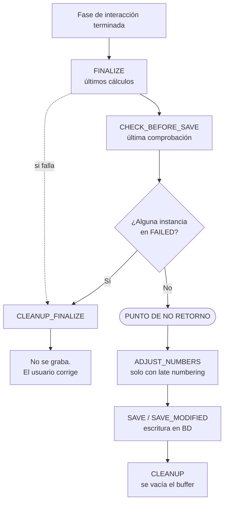

# Capítulo 5 — Behavior Implementation (resumen en español)

> Basado en *ABAP RESTful Application Programming Model*, 2ª ed. (Rheinwerk, 2025), capítulo 5.
> Los términos técnicos se mantienen en inglés, tal como aparecen en ADT y en la documentación de SAP.
> **Listados marcados «Libro»**: proceden del capítulo (recortados). **Listados marcados «Ejemplo propio»**: no son del libro; están escritos para este resumen sobre un BO de gastos ficticio (`ZR_Expense`, alias `Expense`) y no se han compilado en un sistema. Sirven para fijar el patrón, no para copiar sin probar.
> Las erratas detectadas en el libro están corregidas y listadas en el §10.

---

## Índice

1. [Qué es la behavior implementation y cuándo hace falta](#1-qué-es-la-behavior-implementation-y-cuándo-hace-falta)
2. [Cómo se ejecuta RAP: interacción, buffer y save sequence](#2-cómo-se-ejecuta-rap-interacción-buffer-y-save-sequence)
3. [Anatomía del behavior pool](#3-anatomía-del-behavior-pool)
4. [Interaction handler](#4-interaction-handler)
5. [Save handler](#5-save-handler)
6. [Eventos](#6-eventos)
7. [Errores típicos](#7-errores-típicos)
8. [Chuleta: quién implementa qué](#8-chuleta-quién-implementa-qué)
9. [Autoevaluación](#9-autoevaluación)
10. [Erratas y matices respecto al libro](#10-erratas-y-matices-respecto-al-libro)

---

## 1. Qué es la behavior implementation y cuándo hace falta

La **behavior implementation** es el código ABAP que da vida a lo declarado en la behavior definition. La API con la que se escribe se llama **Business Object Provider API**. Las clases ABAP que la contienen se conocen como **behavior pool**, y la BDEF las referencia con `implementation in class … unique`.

Los tres capítulos encajan así:

| Capítulo | Pieza | Papel |
|---|---|---|
| 3 | Behavior definition (BDL) | Se **declara** qué sabe hacer el BO |
| 4 | EML | El **lenguaje** con el que se lee y se modifica el BO |
| 5 | Behavior implementation | Se **programa** lo declarado, usando EML |

¿Cuándo hace falta?

| Situación | ¿Hay que implementar? |
|---|---|
| Managed, y todo lo necesario lo da el runtime de RAP (CRUD puro) | No. El BO puede no tener behavior implementation |
| Managed con lógica propia (validations, determinations, actions, autorizaciones…) | Sí, solo esa parte |
| Unmanaged, o sin operaciones estándar | Sí, **todo**: las operaciones (incluidas create, update, delete) se declaran en BDL y se implementan con ABAP y EML |

---

## 2. Cómo se ejecuta RAP: interacción, buffer y save sequence

El runtime de RAP fija el flujo de proceso de toda operación de negocio. Ese flujo tiene **dos fases** unidas por el **buffer transaccional**.

| | Fase de interacción | Save sequence |
|---|---|---|
| Qué ocurre | Los consumidores (UI Fiori, otro BO, un test) ejecutan operaciones: se modifica la cabecera, se crea una posición, se borra otra | El estado del buffer se graba en la base de datos |
| Dónde quedan los cambios | Solo en memoria, en el buffer transaccional | En base de datos |
| Dónde se implementa | **Interaction handler** | **Save handler** |
| Métodos | `FOR MODIFY`, `FOR READ`, `FOR LOCK`… (§4) | `FINALIZE`, `CHECK_BEFORE_SAVE`, `ADJUST_NUMBERS`, `SAVE`, `CLEANUP` (§5) |

### El buffer transaccional

- En el caso más simple es una **tabla interna** con los datos de las instancias que se están tratando.
- Guarda los *metadatos* de los cambios: qué instancias se han creado, modificado o borrado y qué campos han cambiado.
- Equivale a la **LUW** (logical unit of work) del ABAP clásico, pero modelada de forma explícita.
- Tras la save sequence se reinicializa. En **managed** lo hace RAP; en **unmanaged** hay que vaciarlo a mano en `CLEANUP` (§5.5).

### Quién dispara la grabación

| Tipo de aplicación | Dueño de la transacción | `COMMIT ENTITIES` |
|---|---|---|
| Aplicación RAP (servicio OData) | RAP | Lo lanza RAP tras los cambios |
| Programa no RAP que modifica un BO por EML (un report) | El programa | Debe escribirse explícitamente |

**`COMMIT ENTITIES` y `COMMIT WORK`** están enlazados internamente: uno hace lo mismo que el otro. Así, un dueño de transacción ajeno a RAP no necesita saber que hay un BO RAP anidado en algún punto. `COMMIT ENTITIES` solo añade opciones: recoger `FAILED` y `REPORTED`, y `CONVERT KEY`, que convierte la información de clave de `MAPPED` (por ejemplo un `%CID`) en los campos clave reales.

### La save sequence, paso a paso

Se ejecuta cuando en la fase de interacción se ha disparado con éxito al menos una operación. El orden es fijo y abarca **todos** los BO implicados en la LUW.



Las reglas que hay que retener:

| Momento | Qué se permite | Qué pasa si se incumple |
|---|---|---|
| `FINALIZE` | Última oportunidad de **modificar** datos con EML `MODIFY` | — |
| Después de `FINALIZE` | Ya no se modifican datos | Error en tiempo de ejecución |
| `CHECK_BEFORE_SAVE` | Solo **comprobar**; cada BO tiene ya su estado final | — |
| Antes del punto de no retorno | Pueden producirse errores; se devuelven al usuario para que corrija | Se aborta la grabación de forma controlada |
| Después del punto de no retorno | No se admiten errores de aplicación; lo único que aún cambia es la **numeración** (late numbering) | Un error aquí solo puede ser técnico y debe acabar en **dump** |

---

## 3. Anatomía del behavior pool

La Business Object Provider API es una jerarquía de clases:

| Clase | Papel |
|---|---|
| `CL_ABAP_BEHV` | Clase superior. Define los tipos de datos básicos y los métodos para crear mensajes |
| `CL_ABAP_BEHAVIOR_HANDLER` | Hereda de la anterior. Clase base del **interaction handler** |
| `CL_ABAP_BEHAVIOR_SAVER` | Hereda de la anterior. Clase base del **save handler**; fija la firma de todos los métodos de la save sequence |

El behavior pool tiene dos niveles:

| Nivel | Qué es | Qué contiene |
|---|---|---|
| **Clase global** (`ZBP_…`) | Clase `ABSTRACT FINAL` creada con referencia a una BDEF (`FOR BEHAVIOR OF`). Solo tiene sentido ligada a ese BO | Métodos estáticos, atributos, constantes y tipos de apoyo |
| **Clases locales** (pestaña *Local Types* en ADT) | Heredan de `CL_ABAP_BEHAVIOR_HANDLER` o de `CL_ABAP_BEHAVIOR_SAVER` | **La lógica real**. Puede haber una o varias clases handler |

Convención de nombres habitual (no la fija el libro, la genera ADT): `lhc_<entidad>` para handlers y `lsc_<bo>` para el saver.

---

## 4. Interaction handler

Es una clase local que hereda de `CL_ABAP_BEHAVIOR_HANDLER`. Cada método se declara con una **adición `FOR …`** que le dice a RAP para qué sirve. El nombre del método es libre; lo que cuenta es la adición.

**Libro** — definición de un interaction handler (listado 5.1, unmanaged, recortado):

```abap
CLASS lhc_travel DEFINITION INHERITING FROM cl_abap_behavior_handler.
  PRIVATE SECTION.
    METHODS:
      create_travel     FOR MODIFY
        IMPORTING it_travel_create FOR CREATE travel,
      update_travel     FOR MODIFY
        IMPORTING it_travel_update FOR UPDATE travel,
      delete_travel     FOR MODIFY
        IMPORTING it_travel_delete FOR DELETE travel,
      read_travel       FOR READ
        IMPORTING it_travel FOR READ travel
        RESULT    et_travel,
      create_booking_ba FOR MODIFY
        IMPORTING it_booking_create_ba FOR CREATE travel\_booking,
      lock              FOR LOCK
        IMPORTING it_travel_lock FOR LOCK travel,
      set_travel_status FOR MODIFY
        IMPORTING it_travel_set_status_booked FOR ACTION travel~set_status_booked
        RESULT    et_travel_set_status_booked,
      get_features      FOR FEATURES
        IMPORTING keys REQUEST requested_features FOR travel
        RESULT    result.
ENDCLASS.
```

### 4.0 Vista general de los 12 métodos

| Adición | Para qué sirve | Cuándo lo llama RAP | Recibe | Devuelve |
|---|---|---|---|---|
| `FOR MODIFY` | Create, update, delete, create-by-association y actions | Al ejecutarse la operación | Instancias a tratar (por operación) | `RESULT` en actions |
| `FOR INSTANCE AUTHORIZATION` | Autorización según los datos de la instancia | Justo **antes** de modificar la instancia | Claves + qué operaciones se consultan | `RESULT` con lo permitido |
| `FOR GLOBAL AUTHORIZATION` | Autorización independiente de la instancia | Antes de la operación | Solo qué operaciones se consultan (sin claves) | `RESULT` con lo permitido |
| `FOR FEATURES` | Feature control dinámico por instancia | Por cada operación o campo controlado dinámicamente | Claves + qué features se piden | `RESULT` con el estado de cada feature |
| `FOR GLOBAL FEATURES` | Feature control dinámico global | Igual, sin instancia | Qué features se piden | `RESULT` |
| `FOR LOCK` | Bloqueo de instancias | Automáticamente **antes** de un `FOR MODIFY` | Claves | — |
| `FOR READ` | Leer del buffer transaccional | En cada lectura | Claves + `%CONTROL` | `RESULT` |
| `FOR READ` *by association* | Leer instancias asociadas | En cada lectura por asociación | Claves + `%CONTROL` + `FULL` | `RESULT` y `LINK` |
| `FOR DETERMINE` | Determinations | `on modify`: tras el cambio. `on save`: en FINALIZE | Claves | — |
| `FOR VALIDATE` | Validations | En CHECK_BEFORE_SAVE | Claves | — |
| `FOR NUMBERING` | Early numbering propio | Al crear | Instancias completas | (`MAPPED`) |
| `FOR PRECHECK` | Rechazar peticiones antes de que lleguen al buffer | Antes de la operación | Claves o instancias | — |

### Reglas comunes a todos

- **Parámetros**: la palabra `IMPORTING` es opcional (solo mejora la lectura). Pueden declararse por referencia con `REFERENCE( )`, pero **no** por valor con `VALUE( )`. Al pasar por referencia, **no se pueden modificar**.
- **Tipos**: no se declaran. El compilador ABAP los asigna como tipos derivados de las entidades de la BDEF.
- **Respuestas implícitas** (`FAILED`, `MAPPED`, `REPORTED`): estructuras con **un componente por entidad** del BO. El componente se llama como el **alias** de la BDEF (o como la entidad si no hay alias): `failed-expense`, `reported-item`.
- **Todo es masivo**: parámetros y componentes son tablas. Se programa siempre para N instancias.

Qué respuestas tiene cada método (ver matiz en §10):

| Método | `FAILED` | `MAPPED` | `REPORTED` |
|---|:-:|:-:|:-:|
| `FOR MODIFY` | X | X | X |
| `FOR INSTANCE AUTHORIZATION` | X | – | X |
| `FOR GLOBAL AUTHORIZATION` | – | – | X |
| `FOR FEATURES` | X | – | X |
| `FOR GLOBAL FEATURES` | – | – | X |
| `FOR LOCK` | X | – | X |
| `FOR READ` (y by association) | X | – | X |
| `FOR DETERMINE` | – | – | X |
| `FOR VALIDATE` | X | – | X |
| `FOR NUMBERING` | X | X | X |
| `FOR PRECHECK` | X | – | X |

---

### 4.1 FOR MODIFY

Implementa **todas las operaciones de cambio** de una entidad: create, update, delete, create-by-association y las actions declaradas en la BDEF.

Dos formas de organizarlo:

| Forma | Cómo | Cuándo |
|---|---|---|
| Un método por operación | `create_x FOR MODIFY … FOR CREATE`, `update_x FOR MODIFY … FOR UPDATE`… | Lo habitual: más legible |
| Un solo método para todo | Un `FOR MODIFY` con varios parámetros (`FOR CREATE`, `FOR UPDATE`, `FOR DELETE`, `FOR ACTION`…) | Cuando el código legacy trata varios nodos de una vez (típico en unmanaged). Un método puede cubrir varias entidades (raíz, hija, nieta) |

**Libro** — sintaxis con un método por operación (listado 5.2):

```abap
METHODS:
  create_entity_method  FOR MODIFY
    IMPORTING create_import_parameter FOR CREATE entity,
  update_entity_method  FOR MODIFY
    IMPORTING update_import_parameter FOR UPDATE entity,
  delete_entity_method  FOR MODIFY
    IMPORTING delete_import_parameter FOR DELETE entity,
  action_method         FOR MODIFY
    IMPORTING action_import_parameter FOR ACTION entity~action_name
    RESULT    action_export_parameter,
  create_by_association FOR MODIFY
    IMPORTING create_ba_import_parameter FOR CREATE entity\_association.
```

Puntos clave:

- Se puede repartir el trabajo en varios handlers locales, o incluso en varios behavior pools globales. Se decide caso a caso.
- RAP **no impone un orden** al procesar las operaciones dentro de un `FOR MODIFY`. El orden lógico lo pone quien programa: por ejemplo, create antes que update.
- Al ser todo tablas y poder agrupar operaciones, una sola llamada puede ejecutar cambios muy amplios.

**Libro** — una action (listado 5.4, recortado). El patrón es siempre el mismo: **modificar → releer → devolver resultado**.

```abap
METHODS set_status_completed FOR MODIFY
  IMPORTING keys FOR ACTION travel~acceptTravel
  RESULT    result.

METHOD set_status_completed.
  " 1. Modificar (en local mode: sin comprobaciones de autorización)
  MODIFY ENTITIES OF /dmo/i_travel_m IN LOCAL MODE
    ENTITY travel
      UPDATE FIELDS ( overall_status )
      WITH VALUE #( FOR key IN keys ( travel_id      = key-travel_id
                                      overall_status = 'A' ) )   " Accepted
    FAILED   failed
    REPORTED reported.

  " 2. Releer los datos ya cambiados
  READ ENTITIES OF /dmo/i_travel_m IN LOCAL MODE
    ENTITY travel
      FIELDS ( agency_id customer_id begin_date end_date overall_status … )
      WITH VALUE #( FOR key IN keys ( travel_id = key-travel_id ) )
    RESULT DATA(lt_travel).

  " 3. Devolver el resultado ($self)
  result = VALUE #( FOR travel IN lt_travel ( travel_id = travel-travel_id
                                              %param    = travel ) ).
ENDMETHOD.
```

---

### 4.2 FOR INSTANCE AUTHORIZATION

Comprobación de autorización **según los datos de cada instancia**.

- Se llama justo antes de modificar la instancia.
- Solo se puede comprobar contra el estado **anterior** al cambio: el **before image**.
- **No** se puede comprobar contra los valores que llegan en la petición. Para eso está `FOR PRECHECK` (§4.12).

| Parámetro | Tipo | Contenido |
|---|---|---|
| `keys` (entrada) | Tabla `FOR AUTHORIZATION KEY` | Claves de las instancias a comprobar |
| `requested_authorizations` (`REQUEST`) | Estructura `FOR AUTHORIZATION REQUEST` | Qué operaciones o actions se están consultando |
| `result` (`RESULT`) | Tabla `FOR AUTHORIZATION RESULT` | Lo permitido por instancia. **Si se devuelve vacía, se concede todo** |
| `failed` | Implícito | Fallo técnico (p. ej. instancia no encontrada) |
| `reported` | Implícito | Mensaje de que falta la autorización |

**Libro** — sintaxis de uso real y cuerpo (listado 5.6, recortado):

```abap
METHODS get_instance_authorizations FOR INSTANCE AUTHORIZATION
  IMPORTING keys REQUEST requested_authorizations FOR travel
  RESULT    result.

METHOD get_instance_authorizations.
  " Se lee el before image: solo los campos necesarios para decidir
  READ ENTITIES OF /DMO/I_Travel_D IN LOCAL MODE
    ENTITY Travel
      FIELDS ( AgencyID )
      WITH CORRESPONDING #( keys )
    RESULT DATA(travels)
    FAILED failed.

  CHECK travels IS NOT INITIAL.
  …
  " Por cada instancia: ¿se pidió delete? ¿está autorizado?
  IF delete_requested = abap_true.
    delete_granted = is_delete_granted( <travel_agency_country_code>-country_code ).
    IF delete_granted = abap_false.
      APPEND VALUE #( %tky = travel-%tky
                      %msg = NEW /dmo/cm_flight_messages(
                               textid    = /dmo/cm_flight_messages=>not_authorized_for_agencyid
                               agency_id = travel-AgencyID
                               severity  = if_abap_behv_message=>severity-error )
                      %element-AgencyID = if_abap_behv=>mk-on
                    ) TO reported-travel.
    ENDIF.
  ENDIF.
  …
ENDMETHOD.
```

El `AUTHORITY-CHECK` real queda encapsulado en métodos de apoyo como `is_delete_granted( )`. El resultado por instancia se devuelve en `result` con las constantes `if_abap_behv=>auth-allowed` / `auth-unauthorized` (las mismas del §4.3).

---

### 4.3 FOR GLOBAL AUTHORIZATION

Comprobación **independiente del estado de la instancia**: solo importa el usuario.

- Uso típico: prohibir operaciones a ciertos grupos de usuarios. El caso clásico es **create**: como aún no existe instancia, solo cabe una comprobación global.
- **No recibe claves.**
- Por rendimiento, también conviene prohibir aquí update o delete cuando el usuario no tiene esa autorización en absoluto: así RAP no tiene que recalcularla instancia a instancia.

| Parámetro | Tipo | Contenido |
|---|---|---|
| `requested_authorizations` (`REQUEST`) | Estructura `FOR GLOBAL AUTHORIZATION REQUEST` | Qué operaciones se consultan |
| `result` (`RESULT`) | **Estructura** `FOR GLOBAL AUTHORIZATION RESULT` | Lo permitido |
| `reported` | Implícito | Mensajes |

**Libro** — listado 5.8, recortado:

```abap
METHODS get_global_authorizations FOR GLOBAL AUTHORIZATION
  IMPORTING REQUEST requested_authorizations FOR Entity
  RESULT    result.

METHOD get_global_authorizations.
  IF requested_authorizations-%create = if_abap_behv=>mk-on.
    IF is_create_granted( ) = abap_true.
      result-%create = if_abap_behv=>auth-allowed.
    ELSE.
      result-%create = if_abap_behv=>auth-unauthorized.
      APPEND VALUE #( %msg    = NEW /dmo/cm_flight_messages(
                                  textid   = /dmo/cm_flight_messages=>not_authorized
                                  severity = if_abap_behv_message=>severity-error )
                      %global = if_abap_behv=>mk-on ) TO reported-travel.
    ENDIF.
  ENDIF.

  " Las actions se tratan como un update
  IF requested_authorizations-%update              = if_abap_behv=>mk-on OR
     requested_authorizations-%action-Edit         = if_abap_behv=>mk-on OR
     requested_authorizations-%action-acceptTravel = if_abap_behv=>mk-on.
    …
  ENDIF.
ENDMETHOD.
```

Diferencias entre las dos autorizaciones:

| | Global | Instancia |
|---|---|---|
| ¿Recibe claves? | No | Sí |
| `result` | Estructura | Tabla (una fila por instancia) |
| Se decide por | Usuario | Usuario + datos de la instancia (before image) |
| Sirve para create | **Sí** (es la única opción) | No |
| Mensaje | `%global = mk-on` | `%tky` de la instancia |

---

### 4.4 FOR FEATURES (feature control de instancia)

Implementa el **feature control dinámico**: sobrescribe en ejecución las propiedades declaradas en la BDEF para campos y operaciones (activo/inactivo, solo lectura, obligatorio).

- Se declara en la BDEF con `( features : instance )`.
- RAP llama al método por cada operación o campo controlado dinámicamente.
- En la UI Fiori, el feature control se combina con las autorizaciones: solo quedan habilitadas las operaciones permitidas por ambos.
- El nombre del método es libre; lo habitual es `get_instance_features`.

**Libro** — en la BDEF (listado 5.10):

```
field  ( features : instance ) travel_id;
action ( features : instance ) acceptTravel result [1] $self;
action ( features : instance ) rejectTravel result [1] $self;
association _Booking { create ( features : instance ); }
```

| Parámetro | Contenido |
|---|---|
| `keys` | Claves de las instancias |
| `requested_features` (`REQUEST`) | Qué elementos (campos, operaciones, actions) pide el consumidor |
| `result` | Tabla con las claves y el valor de cada feature. **Si se devuelve vacía, todo queda activo** |

**Libro** — implementación (listado 5.11). Muestra las tres variantes: campo, action y asociación.

```abap
METHOD get_features.
  READ ENTITIES OF /dmo/i_travel_m IN LOCAL MODE
    ENTITY travel
      FIELDS ( travel_id overall_status )
      WITH CORRESPONDING #( keys )
    RESULT DATA(lt_travel_result).

  result = VALUE #( FOR ls_travel IN lt_travel_result
    ( %key = ls_travel-%key
      " 1. Campo: solo lectura
      %field-travel_id = if_abap_behv=>fc-f-read_only
      " 2. Actions: botón activo o no según el estado
      %features-%action-rejectTravel = COND #( WHEN ls_travel-overall_status = 'X'
                                               THEN if_abap_behv=>fc-o-disabled
                                               ELSE if_abap_behv=>fc-o-enabled )
      %features-%action-acceptTravel = COND #( WHEN ls_travel-overall_status = 'A'
                                               THEN if_abap_behv=>fc-o-disabled
                                               ELSE if_abap_behv=>fc-o-enabled )
      " 3. Asociación: se pueden crear reservas o no
      %assoc-_Booking = COND #( WHEN ls_travel-overall_status = 'X'
                                THEN if_abap_behv=>fc-o-disabled
                                ELSE if_abap_behv=>fc-o-enabled ) ) ).
ENDMETHOD.
```

Constantes de `IF_ABAP_BEHV`, estructura `FC`:

| Nivel | Estructura | Valores |
|---|---|---|
| Campo | `fc-f-` | `unrestricted`, `mandatory`, `read_only`, `all` |
| Operación | `fc-o-` | `enabled`, `disabled` |

---

### 4.5 FOR GLOBAL FEATURES

Igual que el anterior, pero **sin referencia a una instancia**. Se declara en la BDEF con `( features : global )`.

- No recibe claves; solo `REQUEST`.
- `result` contiene las operaciones estándar y actions con feature control global.

**Libro** — listado 5.13:

```abap
METHODS get_global_features FOR GLOBAL FEATURES
  IMPORTING REQUEST requested_features FOR entity
  RESULT    result.

METHOD get_global_features.
  result = VALUE #(
    %features-%action-action_name = COND #( WHEN condition
                                            THEN if_abap_behv=>fc-o-disabled
                                            ELSE if_abap_behv=>fc-o-enabled )
    %features-%update             = COND #( WHEN condition
                                            THEN if_abap_behv=>fc-o-disabled
                                            ELSE if_abap_behv=>fc-o-enabled )
    %assoc-_Assoc                 = COND #( WHEN condition
                                            THEN if_abap_behv=>fc-o-disabled
                                            ELSE if_abap_behv=>fc-o-enabled ) ).
ENDMETHOD.
```

---

### 4.6 FOR LOCK

Implementa el bloqueo de instancias según lo declarado en la BDEF (`lock master` / `lock dependent by`).

- RAP lo llama **automáticamente antes** de cada operación de cambio (`FOR MODIFY`).
- Para una entidad `lock dependent`, RAP sigue la asociación hasta el lock master y ejecuta **su** método `FOR LOCK`.
- Recibe las claves. `%CID`, `%CID_REF` y `%PID` no intervienen: solo se bloquean instancias **persistentes**.
- Necesita un **objeto de bloqueo** del diccionario (enqueue/dequeue).

| Escenario | ¿Se implementa `FOR LOCK`? |
|---|---|
| Unmanaged | Sí |
| Managed | No, lo gestiona RAP |
| Managed con `lock master unmanaged` | Sí |

**Libro** — listado 5.15, recortado:

```abap
METHOD lock.
  TRY.
      DATA(lock) = cl_abap_lock_object_factory=>get_instance( iv_name = '/DMO/ETRAVEL' ).
    CATCH cx_abap_lock_failure INTO DATA(exception).
      RAISE SHORTDUMP exception.
  ENDTRY.

  LOOP AT keys ASSIGNING FIELD-SYMBOL(<travel>).
    TRY.
        lock->enqueue( it_parameter = VALUE #( ( name  = 'TRAVEL_ID'
                                                 value = REF #( <travel>-travelid ) ) ) ).
      CATCH cx_abap_foreign_lock INTO DATA(foreign_lock).
        " Otro usuario ya tiene el bloqueo → FAILED + REPORTED
        map_messages( … CHANGING failed   = failed-travel
                                 reported = reported-travel ).
      CATCH cx_abap_lock_failure INTO exception.
        RAISE SHORTDUMP exception.
    ENDTRY.
  ENDLOOP.
ENDMETHOD.
```

Lectura del ejemplo: un bloqueo ajeno es un error **de negocio** (se informa al usuario con `failed` y `reported`); un fallo del propio mecanismo de bloqueo es un error **técnico** (dump).

---

### 4.7 FOR READ

Devuelve los datos **del buffer transaccional**. Si el buffer está vacío, se leen de la base de datos, y normalmente con eso se rellena el buffer.

| Parámetro | Contenido |
|---|---|
| `keys` (entrada) | Claves de las instancias a leer + `%CONTROL`, que marca qué campos pide el consumidor |
| `result` | Tabla con lo leído. Solo deben devolverse los campos marcados en `%CONTROL` |

En **managed** no se implementa: RAP lee el buffer. Es un método propio de **unmanaged**.

**Ejemplo propio** — lectura mínima en unmanaged (un caso real consultaría antes el buffer):

```abap
METHODS read_expense FOR READ
  IMPORTING keys FOR READ Expense
  RESULT    result.

METHOD read_expense.
  LOOP AT keys INTO DATA(key).
    SELECT SINGLE * FROM zexpense_a
      WHERE expense_uuid = @key-ExpenseUuid
      INTO @DATA(ls_expense).

    IF sy-subrc = 0.
      " Encontrado → a RESULT, con los nombres de la entidad
      APPEND CORRESPONDING #( ls_expense MAPPING TO ENTITY ) TO result.
    ELSE.
      " No encontrado → a FAILED con la causa
      APPEND VALUE #( %tky        = key-%tky
                      %fail-cause = if_abap_behv=>cause-not_found ) TO failed-expense.
    ENDIF.
  ENDLOOP.
ENDMETHOD.
```

Regla para recordar: **cada clave pedida acaba en `result` o en `failed`**.

---

### 4.8 FOR READ by association

Devuelve del buffer las instancias **asociadas** (p. ej. las posiciones de una cabecera).

| Parámetro | Contenido |
|---|---|
| `keys` (entrada) | Claves del **origen** + `%CONTROL` |
| `FULL` (entrada, booleano) | `true`: hay que rellenar `result`. `false`: basta con `LINK` |
| `RESULT` | Datos de las instancias asociadas (solo si `FULL` está activo) |
| `LINK` | Pares clave origen → clave destino de lo leído |

**Libro** — listado 5.18, recortado. Unmanaged: se llama a un módulo de funciones legacy.

```abap
METHODS read_booking_ba FOR READ
  IMPORTING it_travel FOR READ travel\_Booking
            FULL iv_full_requested
  RESULT    et_booking
  LINK      et_link_table.

METHOD read_booking_ba.
  LOOP AT it_travel ASSIGNING FIELD-SYMBOL(<fs_travel_rba>)
       GROUP BY <fs_travel_rba>-TravelID.

    CALL FUNCTION '/DMO/FLIGHT_TRAVEL_READ'
      EXPORTING iv_travel_id = <fs_travel_rba>-travelid
      IMPORTING et_booking   = lt_booking_out
                et_messages  = lt_message.

    IF lt_message IS INITIAL.
      LOOP AT lt_booking_out ASSIGNING FIELD-SYMBOL(<fs_booking>).
        " LINK: siempre
        INSERT VALUE #( source-%key = <fs_travel_rba>-%key
                        target-%key = VALUE #( TravelID  = <fs_booking>-travel_id
                                               BookingID = <fs_booking>-booking_id ) )
          INTO TABLE et_link_table.
        " RESULT: solo si se pidió FULL
        IF iv_full_requested = abap_true.
          ls_booking = CORRESPONDING #( <fs_booking> MAPPING TO ENTITY ).
          INSERT ls_booking INTO TABLE et_booking.
        ENDIF.
      ENDLOOP.
    ELSE.
      " Error → FAILED con la causa
      failed-travel = VALUE #( BASE failed-travel
        FOR msg IN lt_message (
          %key        = <fs_travel_rba>-TravelID
          %fail-cause = COND #( WHEN msg-msgty = 'E' AND ( msg-msgno = '016' OR msg-msgno = '009' )
                                THEN if_abap_behv=>cause-not_found
                                ELSE if_abap_behv=>cause-unspecific ) ) ).
    ENDIF.
  ENDLOOP.
ENDMETHOD.
```

---

### 4.9 FOR DETERMINE

Implementa las **determinations**: ajustes y cálculos automáticos. Ejemplo del libro: ajustar el estado de la cabecera a partir de los estados de las posiciones.

- La firma indica el momento (`ON MODIFY` u `ON SAVE`), la entidad (alias) y el nombre de la determination de la BDEF.
- Recibe `keys`: las claves de las instancias para las que hay que ejecutarla.
- Un mismo método puede implementar **varias determinations de varias entidades** si comparten el momento de disparo.
- Las `on save` se ejecutan en la fase FINALIZE (§5.1).

**Libro** — sintaxis (listado 5.19):

```abap
METHODS method_name1 FOR DETERMINE ON MODIFY
  IMPORTING keys  FOR AliasedEntityName~DetOnModify.

METHODS method_name2 FOR DETERMINE ON SAVE
  IMPORTING keys  FOR AliasedEntityName~DetOnSave
            keys2 FOR AliasedEntityName2~DetOnSave2.
```

**Ejemplo propio** — estado inicial «Nuevo» al crear un gasto. BDEF: `determination setInitialStatus on modify { create; }`.

```abap
METHODS setInitialStatus FOR DETERMINE ON MODIFY
  IMPORTING keys FOR Expense~setInitialStatus.

METHOD setInitialStatus.
  " 1. LEER solo lo necesario
  READ ENTITIES OF ZR_Expense IN LOCAL MODE
    ENTITY Expense
      FIELDS ( Status )
      WITH CORRESPONDING #( keys )
    RESULT DATA(expenses).

  " 2. FILTRAR: solo las que aún no tienen estado
  DELETE expenses WHERE Status IS NOT INITIAL.
  CHECK expenses IS NOT INITIAL.

  " 3. MODIFICAR
  MODIFY ENTITIES OF ZR_Expense IN LOCAL MODE
    ENTITY Expense
      UPDATE FIELDS ( Status )
      WITH VALUE #( FOR expense IN expenses ( %tky   = expense-%tky
                                              Status = 'N' ) )   " Nuevo
    REPORTED DATA(update_reported).

  reported = CORRESPONDING #( DEEP update_reported ).
ENDMETHOD.
```

Patrón para recordar: **leer → filtrar → modificar**. El filtro evita trabajo inútil y cascadas innecesarias (cap. 3, §13).

---

### 4.10 FOR VALIDATE

Implementa las **validations**: comprobaciones de consistencia que impiden grabar datos incorrectos. Su interfaz permite enviar mensajes al consumidor para que corrija.

- Siempre `ON SAVE`. Se ejecutan en CHECK_BEFORE_SAVE (§5.2).
- Recibe `keys`. Igual que en las determinations, un método puede cubrir varias validations.
- **No modifica datos**: solo lee y responde.

**Libro** — sintaxis (listado 5.20, corregido):

```abap
METHODS method_name1 FOR VALIDATE ON SAVE
  IMPORTING keys  FOR AliasedEntityName~MyValidation.

METHODS method_name2 FOR VALIDATE ON SAVE
  IMPORTING keys  FOR AliasedEntityName~AnotherValidation
            keys2 FOR AliasedEntityName2~AnotherValidation2.
```

**Ejemplo propio** — la fecha de fin no puede ser anterior a la de inicio. BDEF: `validation validateDates on save { create; field BeginDate, EndDate; }`.

```abap
METHODS validateDates FOR VALIDATE ON SAVE
  IMPORTING keys FOR Expense~validateDates.

METHOD validateDates.
  " 1. LEER
  READ ENTITIES OF ZR_Expense IN LOCAL MODE
    ENTITY Expense
      FIELDS ( BeginDate EndDate )
      WITH CORRESPONDING #( keys )
    RESULT DATA(expenses).

  " 2. COMPROBAR
  LOOP AT expenses INTO DATA(expense).
    IF expense-EndDate < expense-BeginDate.
      " 3. RESPONDER: FAILED (qué instancia) + REPORTED (por qué y en qué campo)
      APPEND VALUE #( %tky = expense-%tky ) TO failed-expense.

      APPEND VALUE #( %tky             = expense-%tky
                      %msg             = new_message_with_text(
                                           severity = if_abap_behv_message=>severity-error
                                           text     = 'La fecha de fin es anterior a la de inicio' )
                      %element-EndDate = if_abap_behv=>mk-on ) TO reported-expense.
    ENDIF.
  ENDLOOP.
ENDMETHOD.
```

Patrón para recordar: **leer → comprobar → responder**. `failed` detiene la grabación; `reported` explica el motivo y `%element` marca el campo en la UI.

Determination frente a validation:

| | Determination | Validation |
|---|---|---|
| Hace | Calcula y **modifica** | **Comprueba**, no modifica |
| Momento | `on modify` u `on save` | Solo `on save` |
| Fase de la save sequence | FINALIZE (las `on save`) | CHECK_BEFORE_SAVE |
| Patrón | leer → filtrar → modificar | leer → comprobar → responder |
| Respuesta principal | `reported` | `failed` + `reported` |

---

### 4.11 FOR NUMBERING

Implementa el **early numbering propio** (la BDEF declara `early numbering`): la clave la asigna el código al crear, no RAP.

- No se puede combinar con `numbering : managed`. Hay que decidir en la BDEF quién numera.
- Recibe `entities`: las instancias completas que se están creando.
- **Regla estricta**: cada instancia recibida debe terminar en `MAPPED` o en `FAILED`. Si alguna se queda fuera, se produce un **dump**.

**Libro** — listado 5.21, recortado:

```abap
METHODS earlynumbering_create FOR NUMBERING
  IMPORTING entities FOR CREATE travel.

METHOD earlynumbering_create.
  …
  " Se piden de una vez tantos números como instancias sin clave
  cl_numberrange_runtime=>number_get(
    EXPORTING nr_range_nr       = '01'
              object            = '/DMO/TRV_M'
              quantity          = CONV #( lines( entities_wo_travelid ) )
    IMPORTING number            = DATA(number_range_key)
              returncode        = DATA(number_range_return_code)
              returned_quantity = DATA(number_range_returned_quantity) ).
  …
  travel_id_max = number_range_key - number_range_returned_quantity.

  " Cada instancia recibe su clave y se registra en MAPPED
  LOOP AT entities_wo_travelid INTO entity.
    travel_id_max += 1.
    entity-travel_id = travel_id_max.
    APPEND VALUE #( %cid = entity-%cid
                    %key = entity-%key ) TO mapped-travel.
  ENDLOOP.
ENDMETHOD.
```

Detalles del ejemplo: el rango se consume **una sola vez** para todo el lote (programación masiva), y si el rango entra en zona crítica se añade un aviso (*warning*) a `reported` sin detener la creación.

---

### 4.12 FOR PRECHECK

Permite **rechazar una petición antes de que sus datos lleguen al buffer transaccional**. Se declara en la BDEF con `( precheck )` sobre la operación.

- Solo para comprobar **consistencia y corrección de los datos entrantes**.
- Las autorizaciones **no** van aquí: van en `FOR INSTANCE / GLOBAL AUTHORIZATION`.
- Se puede definir para create, create-by-association, update, delete y actions.

**Ejemplo propio** — no se admite crear un gasto con importe negativo. BDEF: `create ( precheck );`.

```abap
METHODS precheck_create FOR PRECHECK
  IMPORTING entities FOR CREATE Expense.

METHOD precheck_create.
  LOOP AT entities INTO DATA(entity) WHERE TotalAmount < 0.
    APPEND VALUE #( %cid = entity-%cid ) TO failed-expense.

    APPEND VALUE #( %cid = entity-%cid
                    %msg = new_message_with_text(
                             severity = if_abap_behv_message=>severity-error
                             text     = 'El importe no puede ser negativo' ) ) TO reported-expense.
  ENDLOOP.
ENDMETHOD.
```

Tres sitios donde se puede decir «no», y qué ve cada uno:

| Método | Momento | Ve | Uso |
|---|---|---|---|
| `FOR … AUTHORIZATION` | Antes de modificar | Usuario y before image | ¿Tiene permiso? |
| `FOR PRECHECK` | Antes de entrar al buffer | **Valores entrantes** | ¿La petición es admisible? |
| `FOR VALIDATE` | Al grabar | Estado final en el buffer | ¿El resultado es consistente? |

---

## 5. Save handler

Es una clase local que hereda de `CL_ABAP_BEHAVIOR_SAVER`. Sus métodos **no se declaran con `FOR …`**: se **redefinen** (`REDEFINITION`) los de la clase base. RAP los llama en orden fijo, para todos los BO implicados en la grabación (diagrama del §2).

### 5.0 Vista general: managed frente a unmanaged

| Paso | Método | En managed | En unmanaged | ¿Admite errores? |
|---|---|---|---|---|
| 1 | `FINALIZE` | Lo cubren las determinations `on save` | Se implementa el método | Sí (`failed`) |
| 2 | `CHECK_BEFORE_SAVE` | Lo cubren las validations | Se implementa el método | Sí (`failed`) |
| — | **Punto de no retorno** | | | |
| 3 | `ADJUST_NUMBERS` | Solo si la BDEF declara `late numbering` | Solo si la BDEF declara `late numbering` | No |
| 4 | `SAVE` / `SAVE_MODIFIED` | Graba RAP. `SAVE_MODIFIED` solo con *additional* o *unmanaged save* | Se implementa `SAVE` | No |
| 5 | `CLEANUP` | Lo hace RAP. Propio solo con `… and cleanup` | Se implementa siempre | — |
| (error) | `CLEANUP_FINALIZE` | Se puede redefinir | Se puede redefinir | — |

Firmas de la clase base:

| Método | Parámetros |
|---|---|
| `finalize` | `CHANGING failed reported` |
| `check_before_save` | `CHANGING failed reported` |
| `adjust_numbers` | `CHANGING mapped reported` |
| `save_modified` | `IMPORTING create update delete` · `CHANGING reported` |
| `save` | `CHANGING reported` |
| `cleanup` | — |
| `cleanup_finalize` | — |

Obsérvese que a partir de `adjust_numbers` **desaparece `failed`**: es el punto de no retorno expresado en la firma.

> **Punto de no retorno.** Tras FINALIZE y CHECK_BEFORE_SAVE, RAP da por comprobados y excluidos todos los fallos posibles: todas las instancias son consistentes y ya no se cambian datos. Un error posterior solo puede ser técnico (p. ej. rango de números agotado) y debe terminar en dump. En esos métodos, `reported` solo debe llevar mensajes de éxito o información.

---

### 5.1 FINALIZE

Primer paso. Se hacen los **últimos cálculos** sobre el resultado de la fase de interacción, para todos los BO de la LUW. Es la última oportunidad de usar EML `MODIFY`; después, un `MODIFY` provoca error en ejecución.

- **Managed**: los ajustes finales son las determinations `on save` (§4.9).
- **Unmanaged**: se implementan en el método `FINALIZE`.
- Una entrada en `failed` **aborta** la save sequence.

### 5.2 CHECK_BEFORE_SAVE

Segundo paso, último antes del punto de no retorno. **Comprobaciones de consistencia**; no se modifica nada.

- **Managed**: son las validations (§4.10).
- **Unmanaged**: se implementan en el método `CHECK_BEFORE_SAVE`.
- Una entrada en `failed` **aborta** la save sequence.

### 5.3 ADJUST_NUMBERS

Implementa el **late numbering**. Se llama **después** del punto de no retorno, y eso es lo que garantiza numeración **sin huecos**: cuando se asigna el número ya es seguro que la instancia se va a grabar. Solo hace falta si la BDEF declara `late numbering`.

El trabajo consiste en traducir, dentro de `MAPPED`, la identificación provisional a la clave definitiva:

| Componente | Contenido |
|---|---|
| `%PRE-%PID` | ID provisional usado durante la interacción |
| `%PRE-%TMP` | Clave semántica provisional |
| `%KEY` | **Clave final** que se asigna aquí |

**Libro** — listado 5.28:

```abap
METHOD adjust_numbers.
  …
  APPEND VALUE #( %pre-%pid             = 'MyPID'
                  %pre-%tmp-<key_field> = 'MyPreliminaryKey_InPlace'
                  %key-<key_field>      = 'MyFinalKey'
                ) TO mapped-<entity>.
ENDMETHOD.
```

Si en este punto aún hubiera que abortar, la única salida es un dump.

### 5.4 SAVE y SAVE_MODIFIED

Escritura en base de datos. Qué método se usa depende del tipo de implementación:

| Tipo | Método | Notas |
|---|---|---|
| Managed | — | RAP graba solo |
| Managed `with additional save` | `SAVE_MODIFIED` | RAP graba y además se ejecuta la lógica propia |
| Managed `with unmanaged save` | `SAVE_MODIFIED` | La lógica propia sustituye a la grabación de RAP |
| Unmanaged | `SAVE` | Se graba desde el buffer propio |

`SAVE_MODIFIED` recibe lo ocurrido en la LUW ya clasificado:

| Parámetro | Contenido |
|---|---|
| `create` | Instancias creadas. `%CONTROL` marca los campos informados |
| `update` | Instancias modificadas. `%CONTROL` marca los campos cambiados |
| `delete` | Instancias borradas |

Cada parámetro tiene un componente por entidad: `create-expense`, `update-item`…

**Ejemplo propio** — `with additional save`: se anota en un log cada gasto creado (`zexpense_log` es una tabla ficticia).

```abap
CLASS lsc_expense DEFINITION INHERITING FROM cl_abap_behavior_saver.
  PROTECTED SECTION.
    METHODS save_modified REDEFINITION.
ENDCLASS.

CLASS lsc_expense IMPLEMENTATION.
  METHOD save_modified.
    IF create-expense IS NOT INITIAL.
      INSERT zexpense_log FROM TABLE @( VALUE #(
        FOR expense IN create-expense ( expense_uuid = expense-ExpenseUuid
                                        created_by   = sy-uname ) ) ).
    ENDIF.
  ENDMETHOD.
ENDCLASS.
```

### 5.5 CLEANUP

**Vacía el buffer transaccional**, con lo que termina la LUW y puede empezar otra.

- Se llama al terminar la save sequence.
- También puede llamarse tras un `ROLLBACK ENTITIES`.
- Se llama para **todos** los BO afectados, hayan fallado o no.

### 5.6 CLEANUP_FINALIZE

Vacía el buffer cuando **`FINALIZE` o `CHECK_BEFORE_SAVE` han fallado**. Es la rama de error del diagrama del §2. Se implementa de forma análoga a `CLEANUP`.

### Ejemplo propio — saver completo en unmanaged

Supone una clase de buffer ficticia, `zcl_expense_buffer`, con tres tablas estáticas (`mt_create`, `mt_update`, `mt_delete`) que los métodos `FOR MODIFY` han ido rellenando durante la interacción.

```abap
CLASS lsc_expense DEFINITION INHERITING FROM cl_abap_behavior_saver.
  PROTECTED SECTION.
    METHODS finalize          REDEFINITION.
    METHODS check_before_save REDEFINITION.
    METHODS save              REDEFINITION.
    METHODS cleanup           REDEFINITION.
    METHODS cleanup_finalize  REDEFINITION.
ENDCLASS.

CLASS lsc_expense IMPLEMENTATION.

  METHOD finalize.
    " Últimos cálculos sobre el buffer (aquí no hay ninguno)
  ENDMETHOD.

  METHOD check_before_save.
    " Última comprobación: si algo falla → FAILED y no se graba
    LOOP AT zcl_expense_buffer=>mt_create INTO DATA(ls_expense).
      IF ls_expense-end_date < ls_expense-begin_date.
        APPEND VALUE #( ExpenseUuid = ls_expense-expense_uuid ) TO failed-expense.
      ENDIF.
    ENDLOOP.
  ENDMETHOD.

  METHOD save.
    " Ya no puede fallar nada: solo escribir
    INSERT zexpense_a FROM TABLE @zcl_expense_buffer=>mt_create.
    UPDATE zexpense_a FROM TABLE @zcl_expense_buffer=>mt_update.
    DELETE zexpense_a FROM TABLE @zcl_expense_buffer=>mt_delete.
  ENDMETHOD.

  METHOD cleanup.
    " Buffer vacío → nueva LUW
    CLEAR: zcl_expense_buffer=>mt_create,
           zcl_expense_buffer=>mt_update,
           zcl_expense_buffer=>mt_delete.
  ENDMETHOD.

  METHOD cleanup_finalize.
    " Rama de error: FINALIZE o CHECK_BEFORE_SAVE fallaron
  ENDMETHOD.

ENDCLASS.
```

Regla para recordar la secuencia: **calcular → comprobar → (numerar) → grabar → limpiar**.

---

## 6. Eventos

Los **business events** (cap. 3, §16) dan soporte a una arquitectura dirigida por eventos: comunicación **asíncrona** entre un proveedor y un consumidor cuando no hace falta respuesta directa.

- Un evento se lanza cuando el estado de un BO cambia de forma significativa (creación, modificación…).
- El proveedor **no sabe nada** del consumidor: no hay comunicación de ida y vuelta.
- El consumidor reacciona y dispara las acciones posteriores que le correspondan.

### 6.1 Lanzar un evento

| Pieza | Papel |
|---|---|
| `event …` en la BDEF | Definición del evento (con o sin parámetro) |
| **Event binding** (objeto de desarrollo) | Definición en *design time*: asigna el evento a un namespace, al BO y a una operación |
| `RAISE ENTITY EVENT` | Sentencia que lo lanza en ejecución |

**Cuándo se lanza**: en la **parte tardía de la save sequence**, pasado el punto de no retorno, cuando el cambio de estado ya es firme. En la práctica, en `SAVE_MODIFIED` (managed con *additional save*).

**Ejemplo propio** — BDEF: `event Created;`

```abap
METHOD save_modified.
  IF create-expense IS NOT INITIAL.
    RAISE ENTITY EVENT ZR_Expense~Created
      FROM VALUE #( FOR expense IN create-expense ( %key = expense-%key ) ).
  ENDIF.
ENDMETHOD.
```

### 6.2 Consumir un evento

| | Consumo local | Consumo remoto |
|---|---|---|
| Dónde | En el mismo sistema | En un sistema conectado |
| Con qué | Clase **event handler** | **SAP Event Mesh** (servicio de SAP BTP, Cloud Foundry) |
| Requisito | El evento debe estar expuesto en una business object interface liberada con contrato **C1** | Colas de eventos creadas y un *communication arrangement* para el BO (cap. 13) |

#### Consumo local

La clase event handler se monta igual que un behavior pool: clase global + clase local.

| Nivel | Clave |
|---|---|
| Clase global | `ABSTRACT FINAL` con la adición `FOR EVENTS OF <bdef>` |
| Clase local | Hereda de `cl_abap_behavior_event_handler`; método con `FOR ENTITY EVENT … FOR <Entidad>~<Evento>` |

**Libro** — listados 5.31 a 5.33 (reaccionar al evento `Changed` del pedido de venta):

```abap
" Clase global
CLASS zcl_event_test DEFINITION PUBLIC ABSTRACT FINAL
  FOR EVENTS OF i_salesordertp.
ENDCLASS.

" Clase local (pestaña Local Types)
CLASS lcl_local_event_consumption DEFINITION
  INHERITING FROM cl_abap_behavior_event_handler.
  PRIVATE SECTION.
    METHODS salesorder_changed FOR ENTITY EVENT
      changed_salesorders FOR SalesOrder~Changed.
ENDCLASS.

CLASS lcl_local_event_consumption IMPLEMENTATION.
  METHOD salesorder_changed.
    LOOP AT changed_salesorders INTO DATA(ls_changed_salesorder).
      MODIFY ENTITIES OF i_salesordertp IN LOCAL MODE
        ENTITY SalesOrderText
          UPDATE FIELDS ( LongText )
          WITH VALUE #( ( %key-SalesOrder = ls_changed_salesorder-SalesOrder
                          %key-Language   = 'D'
                          %key-LongTextID = 'TX01'
                          LongText        = 'Text updated by Event' ) )
        FAILED   DATA(ls_failed)
        REPORTED DATA(ls_reported).
    ENDLOOP.
  ENDMETHOD.
ENDCLASS.
```

El método recibe las instancias afectadas por el evento. Dentro cabe cualquier reacción: enviar un correo, lanzar un proceso posterior… Si se modifica el mismo BO que originó el evento, el libro recomienda `IN LOCAL MODE` para evitar problemas de bloqueo.

#### Consumo remoto (SAP Event Mesh)

- Event Mesh entrega los mensajes; el emisor no necesita saber qué aplicaciones los reciben.
- Los consumidores se **suscriben a colas**. La cola guarda los mensajes hasta que la aplicación los procesa y garantiza el orden.
- Caso más simple: una cola por aplicación consumidora (relación uno a uno).
- También se puede publicar por **topics**: el evento se envía a un topic y una suscripción de cola lo retiene hasta que se consume.
- Caso típico: eventos lanzados en uno o varios SAP S/4HANA y consumidos en un servicio de Cloud Foundry en BTP.
- El libro remite a un tutorial de SAP Learning para el montaje completo: http://s-prs.de/v1007808

---

## 7. Errores típicos

| Error | Forma correcta |
|---|---|
| Comprobar autorización contra los valores entrantes en `FOR INSTANCE AUTHORIZATION` | Ahí solo hay before image. Los valores entrantes se comprueban en `FOR PRECHECK` |
| Poner comprobaciones de autorización en `FOR PRECHECK` o en `FOR FEATURES` | Autorización en `FOR … AUTHORIZATION`; precheck = consistencia; features = estado de negocio |
| Modificar datos en una validation | La validation solo lee y responde. Para modificar, una determination |
| Usar `MODIFY ENTITIES` después de FINALIZE | Error en ejecución. Los últimos cambios van en FINALIZE o en determinations `on save` |
| Devolver errores (`failed`) en `ADJUST_NUMBERS`, `SAVE` o `SAVE_MODIFIED` | Tras el punto de no retorno solo caben mensajes de éxito o información; si hay que abortar, dump |
| En `FOR NUMBERING`, dejar una instancia sin registrar | Cada instancia debe ir a `MAPPED` o a `FAILED`, o se produce dump |
| Olvidar `CLEANUP` en unmanaged | El buffer propio debe vaciarse a mano; si no, arrastra datos a la siguiente LUW |
| Rellenar `failed` sin `reported` | El usuario ve que falla pero no por qué. Siempre los dos |
| Programar para una sola instancia (`keys[ 1 ]`) | Todo es masivo: siempre tablas y `LOOP` / `FOR` |
| Declarar parámetros con `VALUE( )` | No se permite. Solo por referencia |
| Implementar `FOR LOCK` en managed estándar | Lo gestiona RAP. Solo con `lock master unmanaged` o en unmanaged |
| Combinar `early numbering` con `numbering : managed` | Son excluyentes: o numera el código o numera RAP |
| Lanzar eventos durante la interacción | Se lanzan en la save sequence tardía, cuando el cambio ya es firme |

---

## 8. Chuleta: quién implementa qué

| Qué | Managed | Unmanaged |
|---|---|---|
| Create / update / delete | RAP | `FOR MODIFY` |
| Create-by-association | RAP | `FOR MODIFY … FOR CREATE entidad\_asoc` |
| Actions | `FOR MODIFY … FOR ACTION` | `FOR MODIFY … FOR ACTION` |
| Lectura | RAP | `FOR READ` |
| Lectura por asociación | RAP | `FOR READ … entidad\_asoc` |
| Bloqueo | RAP (salvo `lock master unmanaged`) | `FOR LOCK` |
| Autorización global | `FOR GLOBAL AUTHORIZATION` | `FOR GLOBAL AUTHORIZATION` |
| Autorización de instancia | `FOR INSTANCE AUTHORIZATION` | `FOR INSTANCE AUTHORIZATION` |
| Feature control | `FOR FEATURES` / `FOR GLOBAL FEATURES` | `FOR FEATURES` / `FOR GLOBAL FEATURES` |
| Precheck | `FOR PRECHECK` | `FOR PRECHECK` |
| Early numbering propio | `FOR NUMBERING` | En el propio create |
| Cálculos finales | Determinations `on save` | `FINALIZE` |
| Comprobaciones finales | Validations | `CHECK_BEFORE_SAVE` |
| Late numbering | `ADJUST_NUMBERS` | `ADJUST_NUMBERS` |
| Grabación | RAP, o `SAVE_MODIFIED` | `SAVE` |
| Limpieza del buffer | RAP, o `CLEANUP` con `and cleanup` | `CLEANUP` |

Los tres patrones de este capítulo:

| Método | Patrón |
|---|---|
| Action | modificar → releer → devolver `result` |
| Determination | leer → filtrar → modificar |
| Validation | leer → comprobar → responder (`failed` + `reported`) |

---

## 9. Autoevaluación

1. ¿Qué dos fases tiene el flujo de proceso de RAP y qué las une?
2. ¿En qué se diferencian la clase global y las clases locales de un behavior pool?
3. ¿De qué clases heredan el interaction handler y el save handler?
4. ¿Cómo se llaman los componentes de `failed` y `reported`, y por qué son tablas?
5. ¿Por qué `FOR INSTANCE AUTHORIZATION` no puede comprobar los valores que envía el usuario? ¿Qué método sí puede?
6. ¿Por qué la autorización de create solo puede ser global?
7. ¿Qué ocurre si `FOR FEATURES` devuelve `result` vacío? ¿Y `FOR INSTANCE AUTHORIZATION`?
8. ¿Cuándo llama RAP a `FOR LOCK` y en qué escenarios hay que implementarlo?
9. En un read-by-association, ¿para qué sirve el parámetro `FULL`?
10. ¿Qué pasa en `FOR NUMBERING` si una instancia no acaba ni en `mapped` ni en `failed`?
11. ¿Qué es el punto de no retorno y qué métodos quedan antes y después?
12. ¿Por qué `ADJUST_NUMBERS` garantiza números sin huecos?
13. ¿Qué método de grabación se usa en managed con additional save? ¿Y en unmanaged?
14. ¿Cuándo se llama a `CLEANUP_FINALIZE`?
15. ¿En qué momento se lanza un evento y con qué sentencia?
16. ¿Qué dos piezas forman una clase event handler para consumo local?

<details>
<summary>Respuestas</summary>

1. Fase de interacción y save sequence, unidas por el buffer transaccional.
2. La global (`ABSTRACT FINAL`, ligada a la BDEF) contiene tipos, constantes y métodos de apoyo; las locales contienen la lógica real.
3. `CL_ABAP_BEHAVIOR_HANDLER` y `CL_ABAP_BEHAVIOR_SAVER`; ambas heredan de `CL_ABAP_BEHV`.
4. Como el alias de cada entidad en la BDEF (o el nombre de la entidad). Son tablas porque todo el proceso es masivo.
5. Porque se ejecuta contra el before image. Los valores entrantes se comprueban en `FOR PRECHECK`.
6. Porque en un create todavía no existe instancia sobre la que comprobar.
7. En features, todo queda activo. En autorización, se concede todo.
8. Automáticamente antes de cada `FOR MODIFY`. Se implementa en unmanaged y en managed con `lock master unmanaged`.
9. Indica si hay que devolver los datos en `result` o si basta con rellenar `link`.
10. Se produce un dump.
11. El momento desde el que ya no se admiten errores de aplicación ni cambios de datos. Antes: `FINALIZE` y `CHECK_BEFORE_SAVE`. Después: `ADJUST_NUMBERS`, `SAVE`/`SAVE_MODIFIED`, `CLEANUP`.
12. Porque se ejecuta tras el punto de no retorno: el número se asigna cuando ya es seguro que la instancia se graba.
13. `SAVE_MODIFIED` en managed con additional (o unmanaged) save; `SAVE` en unmanaged.
14. Cuando `FINALIZE` o `CHECK_BEFORE_SAVE` han fallado.
15. En la save sequence tardía, tras el punto de no retorno, con `RAISE ENTITY EVENT`.
16. Una clase global `FOR EVENTS OF <bdef>` y una clase local que hereda de `cl_abap_behavior_event_handler` con un método `FOR ENTITY EVENT`.

</details>

---

## 10. Erratas y matices respecto al libro

| Dónde | En el libro | En este resumen |
|---|---|---|
| Listado 5.20 | `FOR VALIDATE ONE SAVE` | `FOR VALIDATE ON SAVE` |
| Nota de 5.4.4 | Interfaz `IF_ABAP_BHAV`, método `FOR_FEATURES` | `IF_ABAP_BEHV`, `FOR FEATURES` |
| 5.5 (lista de pasos) | «`FOR VALIDATION`» | `FOR VALIDATE` |
| Listado 5.25 | Clase definida como `lcl_saver` e implementada como `lcl_save` | Un solo nombre |
| Listado 5.10 | Línea suelta `acceptTravel result [1] $self;` | Eliminada (duplicado) |
| 5.4.3 | Dice que el `REQUEST` sirve para la comprobación «instance-based» | Es la comprobación **global** |
| 5.4.8 | Lista `read_ba_import_parameter` como parámetro de salida | El de salida es `RESULT` |
| 5.4.4 | Feature control para «create, delete, create-by-association» | Por instancia: update, delete, create-by-association, actions y campos (coherente con cap. 3, §17.1) |
| 5.5 frente a 5.5.3 | Primero dice que en managed `ADJUST_NUMBERS` no se implementa; después, que se implementa si hay late numbering | Se sigue 5.5.3 y el cap. 3: depende de `late numbering`, no del escenario |
| 5.4.5, 5.4.7 a 5.4.10 | Atribuye `FAILED`, `MAPPED` y `REPORTED` a todos esos métodos | **Matiz propio, no del libro**: según la documentación ABAP, `MAPPED` solo existe donde se crean instancias, y varios métodos no tienen `FAILED`. La tabla del §4 refleja eso. Conviene confirmarlo en ADT (F2 sobre el método) |

---

**Siguiente:** capítulo 6 (proyecciones y business services). Pendiente antes o después: práctica de autorizaciones en ZEXPENSE2 (§4.2 y §4.3 de este resumen).
