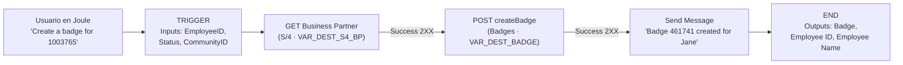

# Joule Studio · Aprendizajes del día y escenarios de práctica

> Preparación **SAP Certified – Joule Studio Developer (C_JSD)** · Examen: **15/12/2026**
> Sesión del 20/11/2026 · Primera skill construida: `RP_CreateBadge` ✅

---

## 1. Lo que construí hoy



| Pieza | Valor real usado |
|---|---|
| Proyecto | `RP_CreateBadge` (tipo *Joule Agent and Skill*) |
| Skill | `CreateBadge` · descripción: *"Create a badge for an employee given the employee's ID"* |
| Action 1 | `Basic-Trial_API_BUSINESS_PARTNER` → GET *Retrieves business partner data by using business partner number* |
| Action 2 | `BasicTrial_BadgeRequestsService` → POST *Invoke action createBadge* |
| Variables de destino | `VAR_DEST_S4_BP` → `S4_BP_data` · `VAR_DEST_BADGE` → `Badge_Service` |
| Environment de prueba | Mi **private environment** (activado en Control Tower → Environments) |

---

## 2. Conceptos clave (en clave ABAP)

### 2.1 La skill es un módulo de función

| Joule Studio | ABAP | Qué es |
|---|---|---|
| **Skill Inputs** | `IMPORTING` | Lo que la skill **recibe** |
| **Skill Outputs** | `EXPORTING` | Lo que la skill **promete devolver** |
| **Nodo Trigger** | Inicio del FM (`FUNCTION ...`) | Donde **llegan** los inputs |
| **Nodo End** | Fin del FM (`ENDFUNCTION`) | Donde se **rellenan** los outputs |

#### ❓ ¿Por qué parece que defino los parámetros en dos sitios (Trigger y End)?

**No se definen dos veces.** Se definen **una sola vez**, a nivel de **skill** (panel *Parameters → Skill Inputs / Skill Outputs*). Ese panel se abre desde el Trigger porque el Trigger representa la skill entera, pero la firma es de la skill, no del nodo.

Lo que se hace en el **End** es otra cosa: **asignar valores** a los outputs ya declarados (el mapeo).

```text
FUNCTION z_create_badge.              " ← TRIGGER: llegan EmployeeID, Status, CommunityID
  *" IMPORTING  iv_employee_id ...     " ← Skill Inputs  (se declaran UNA vez)
  *" EXPORTING  ev_badge ...           " ← Skill Outputs (se declaran UNA vez)

  CALL FUNCTION 'GET_BP' ...           " ← Action 1
  CALL FUNCTION 'CREATE_BADGE' ...     " ← Action 2

  ev_badge = ls_result-badgeid.        " ← END: aquí se ASIGNAN los valores
ENDFUNCTION.
```

> **Regla:** *Inputs* = la firma de entrada (se usan en el Trigger). *Outputs* = la firma de salida (se rellenan en el End).
> El output `Badge` **no existe** al empezar: es una promesa que se cumple al final.

### 2.2 Variables de destino = destino RFC lógico

- Una **action solo guarda la ruta** (`/A_BusinessPartner('{BusinessPartner}')`), **no el servidor**.
- Al usar la action **dentro de una skill**, el paso pide una **variable de destino**: un **hueco con nombre**.
- El hueco se **rellena al probar o desplegar**, cuando se elige el environment y se hace el *matching* variable → destino real.

| Momento | Quién decide el servidor |
|---|---|
| Probar la action en su editor (pestaña *Test*) | Yo, a mano. Solo vale para esa prueba (como la SE37 → *RFC target sys*) |
| Diseñar la skill | Nadie: solo existe el nombre de la variable |
| Test o Deploy de la skill | El *matching*: `VAR_DEST_S4_BP` = `S4_BP_data` |

> En ABAP: `CALL FUNCTION ... DESTINATION lv_dest`, donde `lv_dest` se configura distinto en DEV, QAS y PRD (SM59). El código viaja igual en el transporte.
> Nomenclatura que adopté: prefijo **`VAR_DEST_`** para no confundir la variable con el destino real.

### 2.3 Ramas HTTP de una action = `CASE sy-subrc`

| Rama | Cuándo | ABAP |
|---|---|---|
| **Success 2XX** | La llamada fue bien | `sy-subrc = 0` |
| **4XX** | Error del cliente (p. ej. 404: el BP no existe) | `EXCEPTIONS not_found` |
| **Default** | Cualquier otro caso (500, caída...) | `OTHERS` |

> **El siguiente paso va en la rama Success.** Si lo pongo después de la unión de las ramas, se ejecuta **siempre**, aunque haya fallado (y se crean registros basura).

### 2.4 El panel *Skill Content* (de dónde saco cada dato al mapear)

| Ícono | Bloque | ABAP |
|---|---|---|
| 🩷 Rosa | Salida de una action anterior (`result`) | `EXPORTING` de un FM ya llamado |
| 🟢 Verde `>>>` | Skill Inputs | `IMPORTING` de mi FM |
| 💜 Morado | Skill Metadata (p. ej. `Email` del **usuario que pregunta**, ¡no del empleado!) | `sy-uname` |
| 🧪 | *Apply a formula* | `CONCATENATE`, expresiones |

> Solo aparecen datos de **pasos anteriores**: no se puede leer lo que aún no existe.
> En los mensajes: `${context.action_post_createBadge_1.result.badgeId}` ≈ string template `|{ ls_result-badgeid }|`.

### 2.5 Respuestas al usuario

| Send Response | Para qué |
|---|---|
| **Send Message** ⭐ | Informar el resultado final |
| Send Status Update | Avisar progreso ("procesando...") |
| Send Confirmation Request | Pedir sí/no al usuario. ⚠️ **Rompe la skill si la llama un agente** |

| Tipo de mensaje | Uso |
|---|---|
| Mensaje ilustrado | Confirmación vistosa (dibujo + título + texto) |
| Tarjeta | Ficha con campos y valores (ideal para datos de un BP) |
| Lista | Varios elementos |
| Texto | Texto plano |

> **"Allow Joule to generate a response"** (en el Trigger): si está activo, Joule redacta **una segunda respuesta** a partir de los outputs. Lo desactivé para que solo salga mi mensaje.

### 2.6 Probar y desplegar

| Concepto | Lo que aprendí |
|---|---|
| **Release** | Congela una versión (1.0.0). Ver la versión *Released* oculta el botón Test |
| **Public environment** | Ya **no admite skills de IA** y será descontinuado |
| **Private environment** | Mi sandbox. Se **activa** (no se crea) en Control Tower → Environments |
| **Test** | Prueba desde la versión *Editable*, sin release ni deploy. Pide el environment y el *matching* de variables |
| **Timeline** | Traza de ejecución (como ST05/SAT): Initialize → skill → API calls anidadas → **Localize** (Joule traduce mi mensaje al idioma del usuario) |

### 2.7 Actions y OData

- Una **action** es un envoltorio de una API (no es MCP). Cada operación GET/POST/PATCH/DELETE es una action.
- La action **valida la respuesta contra su esquema de salida**: un registro con `ID = "1"` (no UUID) hizo fallar la GET aunque el servidor respondió **200 OK**.
- `"d": {...}` = **OData V2** (APIs clásicas de S/4, SEGW) · `"value": [...]` = **OData V4** (RAP/CAP).
- Buena práctica: **recortar el Output** de la action a los campos necesarios (la action de BP solo devuelve 3).
- Para ampliar una action compartida: *Save As New Project* (copia propia), como un wrapper `Z` de una BAPI estándar.
- Destinos disponibles en mi trial: `Badge_Service`, `S4_BP_data`, `S4HANA_ODATA_Products`, `S4HANA_OData_ATPcheck`, `sample-maintenance-service`, `Trial_SuccessFactors`, `S4HANA_CLOUD_CPI`.

---

## 3. Defecto de diseño descubierto (y cómo se corrige)

Al pedir *"Create a badge for employee 1003765"* (solo el ID), la skill creó el badge **sin preguntar**, y en la base quedaron `status = null` y `communityId = null`.

| Problema | Corrección |
|---|---|
| `status` vacío | Valor **fijo `NEW`** en el input de la POST (constante) y eliminar el input `Status` de la skill |
| `EmployeeID` opcional | Marcar **Required** → Joule lo pide si falta |
| `communityId` vacío | Marcar **Required**, u obtener el email del BP desde S/4 |

> **Lección de arquitectura:** el video construye "action por action" porque es una demo. En un proyecto real se diseña **de arriba hacia abajo**:
> **necesidad → contrato de la skill (inputs/outputs) → inventario de APIs → action projects recortados → construir y mapear.**
> Es exactamente lo que automatiza el **Joule Studio nuevo** con el ciclo *intent-based*: **Intent Analysis → PRD → Specification → Code → Testing → Deployment**.

---

## 4. Escenarios de práctica

### 🎫 Escenario 1 · Badge Assistant (agente)

**Necesidad:** gestionar el ciclo de vida de las tarjetas de acceso de los empleados.

| Tool (skill) | Action | Qué hace |
|---|---|---|
| `CreateBadge` | (ya construida) | Crea la tarjeta |
| `GetEmployeeBadges` | GET Badges con `$filter=businesspartnerId eq '...'` | Lista las tarjetas de un empleado |
| `ChangeBadgeStatus` | PATCH *Update entity in Badges* | Cambia el estado: `LOST`, `BLOCKED`, `ACTIVE` |

**Reglas para las Instructions:**
1. Antes de crear, consultar si el empleado ya tiene una tarjeta `NEW` o `ACTIVE`. Si la tiene, **no crear** y avisar.
2. Si el usuario dice que perdió la tarjeta, **bloquear la actual** (`LOST`) y **después crear una nueva**.
3. Si falta el ID del empleado, **preguntarlo**. Nunca inventarlo.

**Antes de empezar:** en las skills, quitar el *Send Message*, desactivar *"Allow skill to be started directly by a user"* y no usar *Send Confirmation Request*.

**Pruebas de aceptación:**
- [ ] *"Create a badge for 1003765"* → si ya tiene una, se niega y lo explica.
- [ ] *"Employee 1003764 lost his badge"* → bloquea la vieja y crea una nueva (**2 tools en secuencia**).
- [ ] *"Which badges does 1003764 have?"* → la lista.

---

### 👤 Escenario 2 · BP 360° Assistant (ficha de business partner)

**Necesidad:** consultar un business partner de forma conversacional y obtener una **ficha visual**: como la transacción BP, pero hablando.
**Action:** `Basic-Trial_API_BUSINESS_PARTNER2` (241 operaciones) · **Destino:** `S4_BP_data`.

| Tool (skill) | Actions que encadena | ABAP |
|---|---|---|
| `SearchBusinessPartner` | GET general data con `$filter` por nombre o apellido | `SELECT ... FROM but000 WHERE name_last LIKE ...` |
| `GetBusinessPartner360` | ① general data → ② `to_BusinessPartnerAddress` → ③ email (`A_AddressEmailAddress`) → ④ `to_Customer` | Un FM que llama a 4 BAPIs y arma una estructura |

- **Procedural:** la salida de una GET alimenta a la siguiente (el `AddressID` de ② se usa en ③).
- **Vistoso:** respuesta con mensaje tipo **Tarjeta** (nombre, dirección, email, rol de cliente).

**Antes de construir:** probar en la pestaña *Test* que el S/4 mock tenga **direcciones y emails** cargados. Si no, ajustar la ficha a los datos existentes.

**Pruebas de aceptación:**
- [ ] *"Show me business partner 1003764"* → ficha completa.
- [ ] *"Find business partners with last name Doe"* → lista; luego *"show me the first one"* → ficha (el agente **encadena las dos tools**).

---

### 🔧 Escenario 3 · Maintenance Readiness Agent

**Necesidad:** *"¿Puedo ejecutar la orden de mantenimiento X?"*
**Action:** `Maintenance Fulfillment Agent API` · **Destino:** `sample-maintenance-service`.

| Tool | Operación |
|---|---|
| Leer la orden | `/MaintenanceOrder('{ID}')` |
| Operaciones | `/MaintenanceOrder('{ID}')/operation` |
| Componentes | `/Operation('{ID}')/component` |
| Stock | `/Material('{ID}')/stockLevel` |

El agente razona en varios pasos y da un veredicto (p. ej. *"faltan 3 unidades del material Y"*).
💡 Referencia en el Lobby: *Intelligent Maintenance Stock Validation Agent-Template*.

---

### 🚚 Escenario 4 · Delivery Exception Agent

**Necesidad:** *"¿Llega a tiempo la entrega X? Si no, ¿qué hago?"*
**Action:** `ATP_Check` → *Invoke action CheckAvailability* · **Destino:** `S4HANA_OData_ATPcheck`.

Las Instructions contienen las reglas de decisión: proponer un transportista alternativo o notificar al cliente.
💡 Referencia en el Lobby: *Intelligent Delivery Exception Agent*.

---

## 5. Recordatorios para el examen

- El examen usa un **practice system preconfigurado** (24 h desde la activación). Mis agentes de práctica **no** se presentan: se presentan los del practice system.
- Estructura reportada por candidatos: **8 preguntas** sobre el ejercicio 1, **8** sobre el ejercicio 2 y **8** generales (pilares, SAP AI Agent Hub, MCP vs A2A, supervisión humana).
- Todo en **inglés**: descripciones de skills, instructions y respuestas.
- Mi trial es **classic edition**; el examen podría usar el **Joule Studio nuevo** (intent-based). Los conceptos de este documento valen para ambos.
