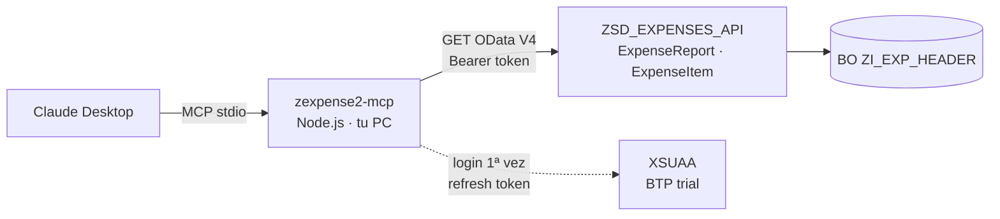

# ZEXPENSE2 · Servidor MCP (solo lectura)

Claude consulta los **informes de gastos** de la app RAP ZEXPENSE2 a través de su API web.

| Herramienta | Qué hace | Escribe |
|---|---|---|
| `buscar_informes_gastos` | Cabeceras filtradas por id, cliente, estado y fechas | ❌ No |
| `ver_posiciones_informe` | Posiciones de un informe + total por moneda | ❌ No |

---

## Puesta en marcha

| # | Paso | Comando o acción |
|---|---|---|
| 1 | Instalar dependencias | `npm install` (en esta carpeta) |
| 2 | Configurar | Copiar `.env.example` como `.env` y pegar el `CLIENT_SECRET` |
| 3 | Login (1ª vez) | `npm run login`: se abre el navegador, entrás con tu usuario SAP |
| 4 | Enchufar a Claude | Copiar el contenido de `claude_desktop_config.example.json` en `%APPDATA%\Claude\claude_desktop_config.json` |
| 5 | Reiniciar Claude Desktop | Cerrarlo del todo (también desde la bandeja del sistema) y abrirlo |
| 6 | Probar | Preguntarle a Claude: *«¿Qué informes de gastos tengo pendientes de aprobación?»* |

---

## Seguridad

| Candado | Dónde |
|---|---|
| El servidor solo hace `GET` y no tiene herramientas de escritura | `src/index.js` |
| `readOnlyHint: true` (pista para el cliente) | Definición de la herramienta |
| Secret y tokens fuera de Git | `.env`, `.tokens.json` en `.gitignore` |

> En producción, el límite lo pondría además un **usuario técnico con rol de solo lectura** (communication arrangement). En la trial no hay permisos de administración, así que el token va con el usuario personal y el límite lo pone el MCP.

---

## Problemas típicos

| Síntoma | Solución |
|---|---|
| `Falta la variable ...` | Revisar el `.env` |
| `El servicio redirigió (302)` | Cambiar en `SERVICE_URL` el host `.abap.` por `.abap-web.` (o al revés) |
| `Tiempo de login agotado` | Ejecutar `npm run login` y volver a preguntar |
| `Refresh falló` | Venció el refresh token: `npm run login` |
| Puerto 8080 ocupado | Cerrar Postman u otra app que use el puerto, o cambiar `CALLBACK_URL` |
