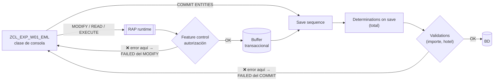
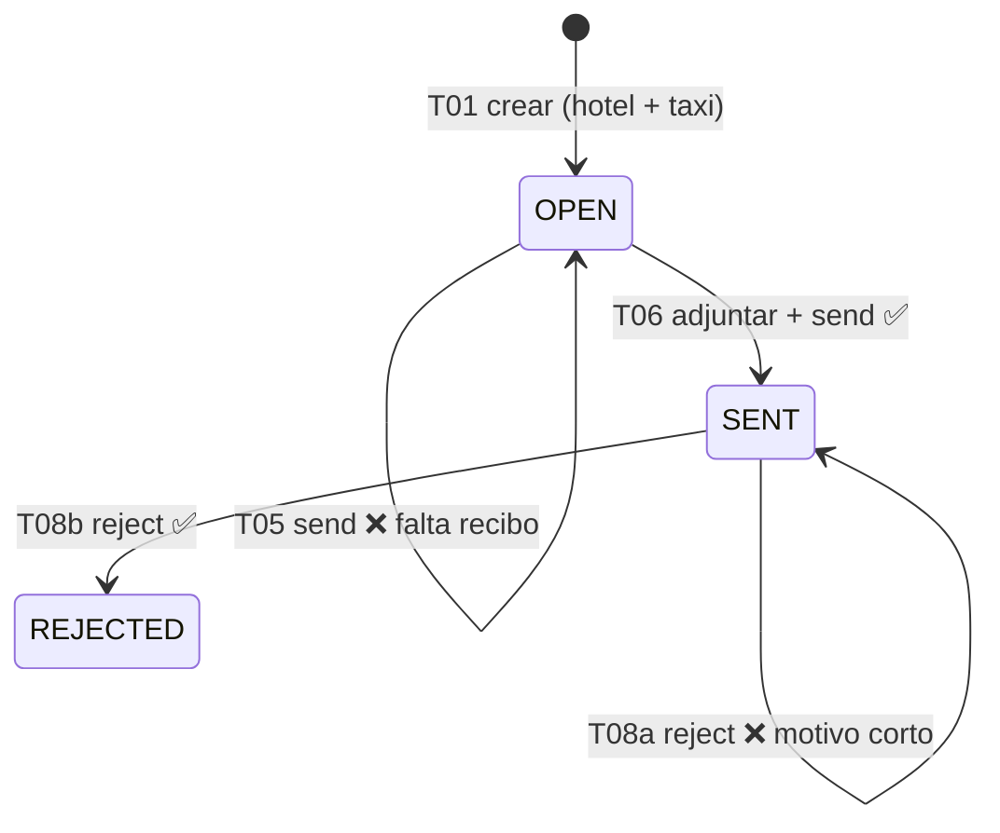
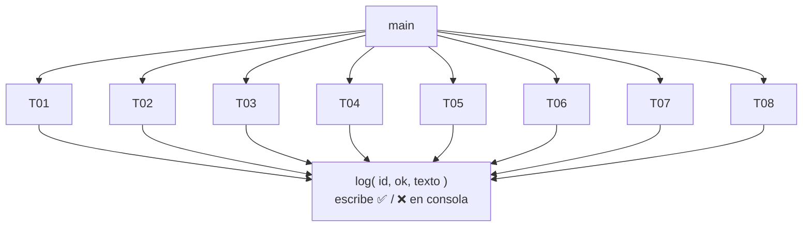

# Semana 1 · EML como consumidor

> **Del 16 al 22 de noviembre de 2026** · Tiempo estimado: **1,5–2 h** · BO: **ZEXPENSE2** (`ZI_EXP_HEADER`) · Sistema: BTP trial

**Objetivo:** manejar tu propio BO desde fuera, solo con EML, como lo haría otro programa o un job, sin Fiori ni Postman.

---

## 1. Qué vas a aprender

| # | Idea clave | Capítulo |
|---|---|---|
| 1 | Crear cabecera + gastos **en una sola sentencia**, enlazados con `%CID` / `%CID_REF` | Cap. 4, §3.2 |
| 2 | Fuera del BO, **tú eres el dueño de la transacción**: sin `COMMIT ENTITIES` no se graba nada | Cap. 4, §3.5 |
| 3 | **Dónde aparece cada error**: unos en `MODIFY`, otros en `COMMIT` | Cap. 5, §2 |
| 4 | Leer `FAILED` / `REPORTED` y reaccionar (`ROLLBACK ENTITIES`) | Cap. 4, §2.2 |

---

## 2. La idea en un diagrama



**Fíjate:** en tu BO managed sin draft, las validations **no** se ejecutan en el `MODIFY`. El `MODIFY` puede ir bien y el `COMMIT` fallar después.

---

## 3. Escenario

> Ana (cliente que exista en `/DMO/I_Customer`) vuelve de un viaje a Madrid. Un programa nocturno crea su informe con dos gastos, lo intenta enviar, se le añade el recibo que falta, lo envía y el responsable lo rechaza.



---

## 4. Qué tienes que construir

Una clase **`ZCL_EXP_W01_EML`** que implemente `if_oo_adt_classrun` (se ejecuta con **F9** en ADT).



- **Un método por caso** (`t01_create_deep`, `t02_read_by_assoc`…).
- **Un método `log`** que imprime `ID · OK/KO · detalle`.
- Al final, un resumen: `7/8 OK`.

### Reglas del juego

| ✅ Obligatorio | 🚫 Prohibido |
|---|---|
| Todo el acceso al BO con **EML** | `SELECT`, `INSERT` o `UPDATE` sobre `ZEXPENSE_*` |
| Recoger **siempre** `FAILED` y `REPORTED` | `IN LOCAL MODE`: estás fuera del BO |
| `COMMIT ENTITIES` **solo si** `FAILED` está vacío | Dejar un error sin `ROLLBACK ENTITIES` |
| Identificar instancias con `%tky` | Ignorar el resultado de una action |
| Cada caso crea sus propios datos (o usa los de T01) | Depender de datos creados a mano en Fiori |

---

## 5. Casos de prueba

**Leyenda de la columna "Falla en":** dónde esperas ver el error. Es lo que más importa entender esta semana.

| ID | Qué haces | Resultado esperado | Falla en |
|---|---|---|---|
| **T01** | Crear un informe con 2 gastos en **un solo** `MODIFY` (hotel 120 €, taxi 30 €). Commit | `MAPPED` trae el `report_id` asignado. Tras releer: estado `OPEN`, moneda `EUR`, total **150** | — |
| **T02** | Leer los gastos del informe de T01 **por asociación** | 2 gastos, importes 120 y 30 | — |
| **T03** | Cambiar el motivo (`reason`) del informe. Commit y releer | El motivo nuevo está grabado | — |
| **T04** ❌ | Crear un informe nuevo con un gasto de **0 €**. Commit | El commit devuelve `FAILED` del item con un mensaje en `REPORTED`. Haces `ROLLBACK ENTITIES`. El informe **no existe** en BD | `COMMIT` |
| **T05** ❌ | Al informe de T01 le añades un gasto de comida de 55 € sin adjunto. Ejecutas `send` | La action devuelve `FAILED` + mensaje en el header. El estado sigue en `OPEN` | `MODIFY` (action) |
| **T06** | Crea un adjunto (PDF de prueba) para cada gasto de más de 50 € **por asociación**. `send` de nuevo. Commit | Estado `SENT` | — |
| **T07** ❌ | Intentar cambiar el motivo del informe en `SENT` | `FAILED` del header. Comprueba **qué causa** (`%fail-cause`) devuelve | `MODIFY` |
| **T08** | a) `reject` con motivo "No" ❌ → error, sigue `SENT`. b) `reject` con un motivo de 10+ caracteres → `REJECTED` y `reject_reason` grabado | a) `FAILED`; b) `REJECTED` | a) `MODIFY` (action) |

### Comprobación manual (2 minutos)

Al terminar, abre la app Fiori de ZEXPENSE2:

- [ ] El informe de T01 aparece **rechazado** (semáforo rojo), con su motivo.
- [ ] Tiene 3 gastos y adjuntos en los de más de 50 €.
- [ ] El informe de T04 **no** aparece.

### Salida esperada en consola

```text
T01 ✅ Informe 0000000012 creado · total 150.00 EUR · estado OPEN
T02 ✅ 2 gastos leídos por asociación
T03 ✅ Motivo actualizado
T04 ✅ Commit rechazado como se esperaba: "<tu mensaje de importe>"
T05 ✅ Send rechazado como se esperaba: "<tu mensaje de recibo>"
T06 ✅ Informe enviado · estado SENT
T07 ✅ Update rechazado · causa <la que obtengas>
T08 ✅ a) motivo corto rechazado · b) estado REJECTED
──────────
8/8 OK
```

> Un caso negativo está **OK** cuando falla **donde y como se esperaba**. Si T04 graba el informe, el caso es **KO**.

---

## 6. Pistas (ábrelas solo si te atascas)

<details>
<summary>T01 · Nivel 1: dónde mirar</summary>

Resumen cap. 4, §3.2 "Create-by-association" y §5.1 (pedido de venta completo en una sentencia). Tu BDEF usa `early numbering`: la clave no la pones tú.
</details>

<details>
<summary>T01 · Nivel 2: qué sintaxis</summary>

`CREATE FIELDS ( … ) WITH` para el header con un `%cid`; `CREATE BY \_Items` con `%cid_ref` y `%target`. La clave asignada sale en `MAPPED-header`. **Experimento:** lee el total **antes** del commit y apúntalo. ¿Por qué sale distinto?
</details>

<details>
<summary>T04 · Nivel 1</summary>

Resumen cap. 4, §3.5 `COMMIT ENTITIES` y su complemento `RESPONSE OF`. Repasa en el cap. 5 en qué fase se ejecutan las validations.
</details>

<details>
<summary>T04 · Nivel 2</summary>

El `FAILED` del `MODIFY` saldrá vacío. El error está en la respuesta del `COMMIT ENTITIES`. Después del fallo, el buffer sigue "sucio": `ROLLBACK ENTITIES`.
</details>

<details>
<summary>T05 / T06 / T08 · Nivel 1</summary>

Resumen cap. 4, §3.2 "Execute (actions)". `reject` lleva parámetro: mira tu entidad abstracta `ZA_EXP_REJECT_PARAM`.
</details>

<details>
<summary>T05 / T06 / T08 · Nivel 2</summary>

`EXECUTE send FROM VALUE #( ( %tky = … ) )`. El parámetro de `reject` va en `%param`. El adjunto se crea desde la entidad `item` con `CREATE BY \_Attachments`; `file_content` admite un `xstring` cualquiera de prueba.
</details>

<details>
<summary>T07 · Nivel 1</summary>

¿Qué impide editar un informe `SENT`: una validation, una autorización o el feature control? Mira tu `get_instance_features`.
</details>

---

## 7. Reto extra (opcional)

| Reto | Qué aprendes |
|---|---|
| Antes de T07, pregunta con `GET PERMISSIONS` si el update está permitido y no lo intentes si no | Preguntar antes de actuar (cap. 4, §3.3) |
| Repite T01 con `AUTO FILL CID` | Ahorrarte inventar `%cid` |

---

## 8. Preguntas de reflexión

Respóndelas con tus palabras en el README del ejercicio. Son las que miraré con más atención.

1. En T01, ¿por qué el total leído **antes** del commit no es 150?
2. T04 y T07 fallan en momentos distintos. Explica por qué con el diagrama del §2.
3. ¿Qué pasaría en T04 si te olvidas del `ROLLBACK ENTITIES` y en el mismo programa haces otro `MODIFY` + `COMMIT` correcto?

**🎤 Pregunta de entrevista:** *"Tenemos un report que crea pedidos con BAPI. ¿Cómo lo harías en S/4 con RAP y qué cambia en el manejo de errores?"* Responde en 4–5 líneas.

---

## 9. Repaso (cap. 3)

- [ ] Tu header tiene `authorization master ( global )`. ¿Qué método obliga a implementar y qué **no** puede comprobar?
- [ ] Tus validations son `on save`. ¿Podría `validateAmount` ser `on modify`?

---

## 10. Entrega y revisión

**Entrega:** carpeta nueva en tu repo (p. ej. `Entrenamiento/01-eml-consumidor/`) con:

- `README.md`: captura de la consola + respuestas del §8 y §9.
- El código de la clase (como haces ahora, en markdown).

**Qué revisaré:**

| Criterio | Peso |
|---|---|
| Los 8 casos pasan, y los negativos fallan **donde** deben | ⭐⭐⭐ |
| Código masivo (tablas, `VALUE #( FOR … )`) y con `%tky` | ⭐⭐ |
| No hay commits con `FAILED` lleno ni errores sin rollback | ⭐⭐ |
| Respuestas de reflexión con tus palabras | ⭐⭐ |
| ATC limpio (variante cloud) | ⭐ |

### Autoevaluación antes de entregar

- [ ] He ejecutado la clase **dos veces seguidas** y sigue dando 8/8 (no depende de datos anteriores).
- [ ] Sé explicar sin mirar qué es `%cid`, `%cid_ref` y `%tky`.
- [ ] Sé decir de memoria en qué fase se ejecuta cada regla de mi BO.

---

> ⚠️ **Antes de empezar, dos comprobaciones en tu sistema:**
> 1. En tu documentación, el límite de hotel de `validateHotelLimit` es **150 €**, pero la tabla `ZEXPENSE_TYPE` dice **300**. Mira cuál usa tu código: el hotel de T01 (120 €) debe quedar por debajo.
> 2. El campo de motivo de `ZA_EXP_REJECT_PARAM` y la causa exacta de T07 dependen de tu implementación. Por eso no los doy: descúbrelos tú.
