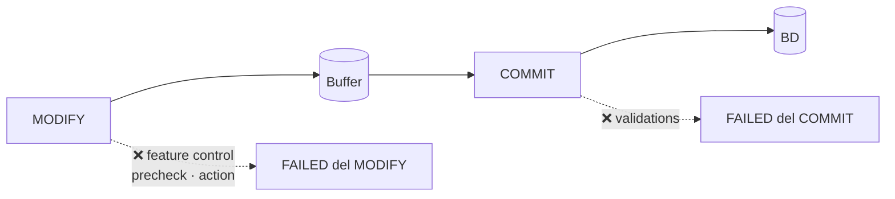
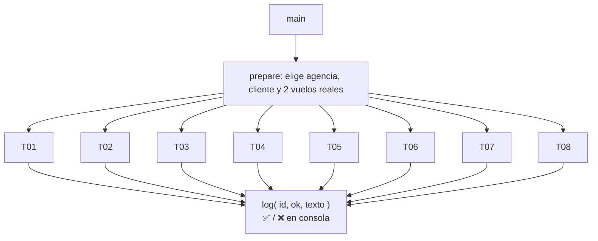

# Semana 1 · EML como consumidor de un BO ajeno

> **Del 16 al 22 de noviembre de 2026** · Tiempo estimado: **1,5–2 h** · Sistema: BTP trial
> BO que vas a consumir: **`/DMO/I_Travel_D`** (interfaz de BO del escenario de vuelos de SAP, ya instalado en el trial)

**Objetivo:** usar un BO **que no es tuyo**, solo a través de su interfaz y con EML, como harás en S/4 con `I_SalesOrderTP` o `I_JournalEntryTP` en lugar de una BAPI.

---

## 0. La idea en una analogía

🛒 **Una transacción RAP es una compra en el supermercado.**

Con `MODIFY` vas llenando el **carrito** (el buffer): todavía no has comprado nada. Con `COMMIT` pasas por **caja** y solo entonces se graba. Y la compra es **todo o nada**: si algo falla en caja, no se cobra nada.

Lo importante es que hay **dos momentos en los que te pueden decir que no**: al coger el producto de la estantería (en el `MODIFY`) o al pagar en caja (en el `COMMIT`). Esta semana vas a aprender a saber cuál de los dos te va a pasar.

Y el supermercado no es tuyo: solo puedes comprar lo que está en sus estanterías (lo que ofrece la interfaz `/DMO/I_Travel_D`), con sus reglas.

---

## 1. Qué sustituye del ABAP tradicional

| ABAP tradicional | RAP / EML | Diferencia clave |
|---|---|---|
| `BAPI_*_CREATE` | `MODIFY ENTITIES … CREATE` | Masivo: N instancias en una llamada |
| Tablas de posiciones en la BAPI (`ITEMS`, `PARTNERS`…) | `CREATE BY \_Booking` + `%CID_REF` | Cabecera y posiciones en **la misma sentencia** |
| `BAPI_*_GETDETAIL` | `READ ENTITIES` | Lee el **buffer**: ve lo no grabado |
| `BAPI_*_CHANGE` + estructura **X** (`…X` / checkbox) | `UPDATE FIELDS ( … )` / `%control` | Misma idea: indicar qué campos cambian |
| Tabla `RETURN` (`BAPIRET2`) | `FAILED` + `REPORTED` | Separan **qué** falló de **por qué** |
| `BAPI_TRANSACTION_COMMIT` | `COMMIT ENTITIES` | Igual: lo pone el dueño de la transacción |
| `BAPI_TRANSACTION_ROLLBACK` | `ROLLBACK ENTITIES` | Igual |
| `ENQUEUE_E…` / `DEQUEUE_E…` | Automático (`lock master`) | Solo usarías `SET LOCKS` para otros BO |
| `AUTHORITY-CHECK` en tu programa | Lo hace el BO | Tú no lo programas: el BO te rechaza |
| `CALL FUNCTION … IN UPDATE TASK` | Save sequence | El framework decide el orden |
| Batch input / `CALL TRANSACTION` | EML | Ya no se simula la pantalla |
| Número de documento en el `EXPORTING` de la BAPI | `MAPPED` + releer tras el commit | Con numeración `on save`, el número llega **después** |

> ⚠️ **La gran diferencia con una BAPI:** la BAPI comprueba casi todo **al llamarla**. RAP deja muchas comprobaciones (las validations) **para el commit**. Por eso un `MODIFY` sin errores **no** garantiza que se vaya a grabar.

---

## 2. Dónde puede fallar



---

## 3. Lo que tienes que construir

Una clase **`ZCL_W01_TRAVEL_IMPORT`** que implemente `if_oo_adt_classrun` (se ejecuta con **F9** en ADT).



- **`prepare`**: lee **datos maestros** existentes (agencia, cliente y 2 vuelos futuros) desde sus CDS de lectura (`/DMO/I_Agency`, `/DMO/I_Customer`, `/DMO/I_Flight`). Así tus casos no dependen de IDs escritos a mano.
- **Un método por caso** y un método `log` que imprime `ID · OK/KO · detalle`.
- Al final, un resumen: `8/8 OK`.

### Reglas del juego

| ✅ Obligatorio | 🚫 Prohibido |
|---|---|
| Escribir **solo** a través de `/DMO/I_Travel_D` | Tocar `/DMO/R_Travel_D` o las tablas `/DMO/A_*` |
| Leer maestros (agencia, cliente, vuelo) con `SELECT` sobre sus CDS | `SELECT` sobre viajes o reservas para comprobar resultados: usa `READ ENTITIES` |
| Recoger **siempre** `FAILED` y `REPORTED` | `IN LOCAL MODE` (estás fuera del BO) |
| `COMMIT ENTITIES` **solo si** no hay `FAILED` | Dejar un error sin `ROLLBACK ENTITIES` |
| Instancias activas: `%is_draft = if_abap_behv=>mk-off` | Mirar el código de `/DMO/BP_TRAVEL_D` **antes** de intentarlo (después, sí) |
| Identificar instancias con `%tky` | Depender de un `TravelID` fijo |

---

## 4. Casos de prueba

Lo importante de esta semana es la columna **"Falla en"**: tienes que predecir **dónde** sale cada error antes de ejecutarlo.

| ID | Qué haces | Resultado esperado | Falla en |
|---|---|---|---|
| **T01** | Crear **un** viaje con **2 reservas** en un solo `MODIFY`. Leer `TravelID` y `TotalPrice` **antes y después** del commit ([ver qué se prueba](#qué-se-prueba-en-t01)) | Antes: `TotalPrice` calculado, `TravelID` **vacío**. Después: `TravelID` asignado, estado `O` | — |
| **T02** | Leer las reservas del viaje de T01 **por asociación** | 2 reservas, cada una con su `BookingID` | — |
| **T03** | `deductDiscount` del 10 % sobre el viaje de T01. Commit | `BookingFee` baja un 10 % y `TotalPrice` se recalcula | — |
| **T04** ❌ | `deductDiscount` del **150 %** | `FAILED` + mensaje. `BookingFee` no cambia | `MODIFY` (lógica de la action) |
| **T05** ❌ | Crear un viaje con `BeginDate` = **ayer**. Commit | El `MODIFY` va bien. El commit devuelve `FAILED` del viaje. `ROLLBACK`. El viaje **no existe** | `COMMIT` |
| **T06** ❌ | Crear un viaje correcto con **1 reserva de un vuelo que no existe**. Commit | El commit falla por la **reserva**, y el viaje **tampoco** se graba | `COMMIT` (todo o nada) |
| **T07** | `acceptTravel` sobre el viaje de T01. Commit | Estado `A` | — |
| **T08** ❌ | `deductDiscount` sobre el viaje **aceptado** | `FAILED` del viaje. Anota **qué** `%fail-cause` devuelve | `MODIFY` (feature control) |

### Qué se prueba en T01

**1. Cabecera y posiciones en una sola sentencia**, enlazadas con `%CID` / `%CID_REF`. Es lo que con una BAPI harías pasando la cabecera y la tabla de posiciones en la misma llamada.

**2. No todos los datos existen en el mismo momento.**

> 🛒 En el supermercado, el **precio** lo ves en la pantalla del carrito mientras compras, pero el **número de ticket** solo te lo dan al pagar en caja.

| Campo | Lo calcula… | ¿Tiene valor antes del commit? |
|---|---|---|
| `TotalPrice` (el precio) | determination `on modify` | ✅ Sí, ya está en el buffer |
| `TravelID` (el ticket) | determination `on save` | ❌ No, hasta el commit está vacío |

**Por qué importa:** `BAPI_SALESORDER_CREATEFROMDAT2` te devuelve el número de pedido en la propia llamada. Muchos BOs RAP numeran **al grabar**. Si tu programa necesita el número (para un log o para devolverlo a la web) y lo lee antes del commit, guardará un número vacío sin darse cuenta. Antes del commit solo tienes el UUID de `MAPPED`.

### Comprobación visual (2 minutos)

El escenario trae su propia app: el service binding **`/DMO/UI_TRAVEL_D_D_O4`** (botón *Preview* en ADT).

- [ ] El viaje de T01 aparece **aceptado**, con 2 reservas y la tarifa con descuento.
- [ ] Los viajes de T05 y T06 **no** aparecen.

### Salida esperada en consola

```text
T01 ✅ Viaje 00004711 creado · antes del commit TravelID = '' · total 1.234,00 USD
T02 ✅ 2 reservas leídas por asociación (BookingID 0001, 0002)
T03 ✅ Descuento aplicado · BookingFee 40,00 → 36,00
T04 ✅ Rechazado en MODIFY: "<mensaje del BO>"
T05 ✅ MODIFY sin errores · rechazado en COMMIT: "<mensaje del BO>"
T06 ✅ Rechazado en COMMIT por la reserva · el viaje tampoco existe
T07 ✅ Viaje aceptado · estado A
T08 ✅ Rechazado en MODIFY · causa <la que obtengas>
──────────
8/8 OK
```

> Un caso negativo está **OK** cuando falla **donde y como se esperaba**. Si T05 graba el viaje, el caso es **KO**.

---

## 5. Pistas (ábrelas solo si te atascas)

<details>
<summary>Antes de empezar · ¿qué ofrece la ventanilla?</summary>

Abre `/DMO/I_Travel_D` (BDEF) en ADT. Todo lo que puedes hacer está en sus líneas `use …`. Pon el cursor en `/DMO/I_Travel_D` y pulsa **F2**. Fíjate en el alias de cada entidad: lo vas a necesitar después de `ENTITY`.
</details>

<details>
<summary>T01 · Nivel 1: dónde mirar</summary>

Resumen cap. 4: §3.2 "Create-by-association" y §5.1 (pedido completo en una sentencia). La clave del viaje es un UUID que pone el BO (`numbering : managed`): tú solo pones el `%cid`.
</details>

<details>
<summary>T01 · Nivel 2: qué sintaxis</summary>

`CREATE FIELDS ( AgencyID CustomerID BeginDate EndDate BookingFee CurrencyCode Description ) WITH …` para el viaje. `CREATE BY \_Booking` con `%cid_ref` y `%target` para las reservas (`CustomerID`, `AirlineID`, `ConnectionID`, `FlightDate`, `FlightPrice`, `CurrencyCode`, `BookingStatus`). El UUID creado sale en `MAPPED-travel`.

**Pregunta para pensar:** ¿por qué `TotalPrice` ya tiene valor antes del commit y `TravelID` no? Mira las determinations del BO base y su momento (`on modify` / `on save`).
</details>

<details>
<summary>T03 / T04 / T07 · Nivel 1</summary>

Resumen cap. 4, §3.2 "Execute (actions)". `deductDiscount` tiene parámetro: mira la entidad abstracta que declara.
</details>

<details>
<summary>T03 / T04 / T07 · Nivel 2</summary>

`EXECUTE deductDiscount FROM VALUE #( ( %tky = … %param-discount_percent = … ) )`. Las actions devuelven `RESULT`: úsalo para comprobar el nuevo `BookingFee` sin otro `READ`.
</details>

<details>
<summary>T05 / T06 · Nivel 1</summary>

Resumen cap. 4, §3.5 `COMMIT ENTITIES` y su complemento `RESPONSE OF`. Repasa en el cap. 5 en qué paso de la save sequence se ejecutan las validations.
</details>

<details>
<summary>T05 / T06 · Nivel 2</summary>

El `FAILED` del `MODIFY` saldrá vacío. El error está en la respuesta del `COMMIT ENTITIES RESPONSE OF /DMO/I_Travel_D`. En T06 busca el error en `failed-booking`, no en `failed-travel`. Después del fallo, el carrito sigue lleno: `ROLLBACK ENTITIES`.
</details>

<details>
<summary>T08 · Nivel 1</summary>

¿Qué te impide aplicar un descuento a un viaje aceptado: una validation, una autorización o el feature control? Mira en la BDEF base qué tiene `features : instance`.
</details>

---

## 6. Reto extra (opcional)

| Reto | Qué aprendes |
|---|---|
| Antes de T08, pregunta con `GET PERMISSIONS` si `deductDiscount` está habilitado, y no lo intentes si no | Preguntar antes de actuar (cap. 4, §3.3) |
| Repite T03 pasando por el **draft**: `Edit` → `deductDiscount` sobre el draft → `Activate` | Es exactamente lo que hace Fiori por debajo |
| Repite T01 con `AUTO FILL CID` | Ahorrarte inventar etiquetas |

---

## 7. Preguntas de reflexión

Respóndelas con tus palabras en el README del ejercicio. Son lo que miraré con más atención.

1. En T01, ¿por qué `TotalPrice` tiene valor antes del commit y `TravelID` no? Explícalo con la analogía del súper.
2. T04 y T05 son errores de datos, pero fallan en momentos distintos. ¿Por qué?
3. En T06 la reserva es la que falla. ¿Por qué tampoco se graba el viaje? ¿Era así con las BAPIs?
4. ¿Qué pasaría si después de T05 no haces `ROLLBACK ENTITIES` y en el mismo programa creas otro viaje correcto y haces commit?

**🎤 Pregunta de entrevista:** *"Tenemos un report que crea pedidos con `BAPI_SALESORDER_CREATEFROMDAT2`. ¿Cómo lo harías en S/4 Cloud y qué cambia en el manejo de errores?"* Responde en 4 o 5 líneas.

---

## 8. Repaso (cap. 3)

- [ ] `/DMO/R_Travel_D` tiene `authorization master ( global, instance )`. ¿Qué métodos obliga a implementar?
- [ ] Tiene `create ( precheck )`. ¿En qué se diferencia de una validation `on save { create; }`?

> En el trial, la autorización de este BO está **simulada**: siempre concede. Por eso no hay caso negativo de autorización: llega en la semana 2, en tu propio BO.

---

## 9. Entrega y revisión

**Entrega:** carpeta nueva en tu repo (p. ej. `Entrenamiento/01-eml-consumidor/`) con:

- `README.md`: captura de la consola + respuestas del §7 y del §8.
- El código de la clase (en markdown, como haces ahora).

**Qué revisaré:**

| Criterio | Peso |
|---|---|
| Los 8 casos pasan y los negativos fallan **donde** deben | ⭐⭐⭐ |
| Solo se usa la interfaz `/DMO/I_Travel_D` | ⭐⭐⭐ |
| Ningún commit con `FAILED` lleno y ningún error sin rollback | ⭐⭐ |
| Código masivo (tablas, `VALUE #( FOR … )`) y con `%tky` | ⭐⭐ |
| Respuestas de reflexión con tus palabras | ⭐⭐ |
| ATC limpio (variante cloud) | ⭐ |

### Autoevaluación antes de entregar

- [ ] He ejecutado la clase **dos veces seguidas** y da 8/8 las dos veces.
- [ ] Sé explicar sin mirar qué son `%cid`, `%cid_ref`, `%tky` y `MAPPED`.
- [ ] Sé decir, para cada regla del BO, si falla en el `MODIFY` o en el `COMMIT`.

---

> ⚠️ **Tres comprobaciones antes de empezar:**
> 1. Abre `/DMO/I_Travel_D` en ADT y comprueba que existe con `acceptTravel`, `deductDiscount` y la asociación `_Booking`. Tu trial puede tener una versión algo distinta de la que he revisado.
> 2. El trial es un sistema **compartido**: puede haber viajes de otros usuarios. Por eso cada caso crea los suyos y nunca usa IDs fijos.
> 3. Los vuelos del escenario tienen fechas generadas al instalarlo. En `prepare` elige vuelos con `FlightDate` **en el futuro**; si no hay, avísame.
